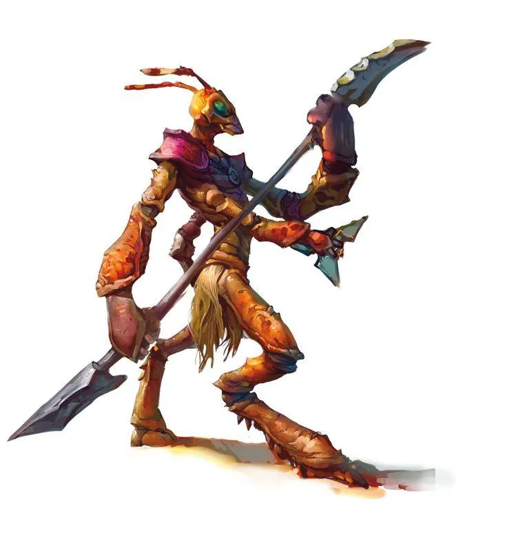

# Thri-kreen

Os thri-kreen vagam pelos desertos e savanas do mundo, evitando todas as outras raças.

***Comunicação Thri-kreen***. Os thri-kreen aplicam um idioma sem palavras. Para demonstrar emoção e reação, um thri-kreen estala suas mandíbulas e balança suas antenas, dando aos outros thri-kreen uma sensação do que está pensando e sentido. As outras criaturas consideram esse meio de comunicação difícil de se interpretar e impossível de se reproduzir.

Quando são forçados a interagir com criaturas inteligentes de outras espécies, os thri-kreen aplicam métodos alternativos de comunicação, como desenhar imagens na areia ou criam imagens com galhos ou folhas de grama.

***Emoções Limitadas***. Os thri-kreen experimentam toda a gama de emoções, mas não são tão propensos a explosões emocionais quanto os humanos. Os thri-kreen com habilidade psiônica frequentemente demonstram uma variedade maior de emoções, particularmente se eles viverem próximo ou interagirem com humanos ou outras criaturas muito emotivas.

***Isolacionistas e Andarilhos***. Os thri-kreen consideram todas as outras criaturas vivas como nutrientes em potencial e eles adoram o sabor da carne dos elfos em particular. Se uma criatura puder ser usado como algo além de alimento, o thri-kreen provavelmente não a atacará à primeira vista. Os thri-kreen matam para sobreviver, nunca por esporte.

***Aqueles que Nunca Dormem***. Os thri-kreen não precisam dormir e podem descansar enquanto permanecem alerta e realizam tarefas leves. Sua inabilidade para dormir é um dos motivos para a expectativa de vida dos thri-kreen ser tão curta, a expectativa de vida média de um thri-kreen é de apenas trinta anos.

> **Variação: Armas e Psiônicos Thri-Kreen**
>
> Alguns thri-kreen usam **armas marciais** especiais. Uma gythka é uma arma de haste de duas mãos com uma lâmina em cada ponta. Uma chatkcha é uma cunha chata e triangular com três lâminas serrilhadas (uma arma leve de arremesso). Um thri-kreen armado com uma gythka e chatkchas ganha as seguintes opções de ação:
>
> ***Ataques Múltiplos***. O thri-kreen realiza dois ataques de gythka ou dois ataques de chatkcha.
>
> ***Gythka***. *Ataque Corpo-a-Corpo com Arma*: +3 para atingir, alcance 1,5 m, um alvo. *Acerto*: 5 (1d8 + 1) de dano cortante.
>
> ***Chatkcha***. *Ataque à Distância com Arma*: +4 para atingir, distância 9/36 m, um alvo. *Acerto*: 5 (1d6 + 2) de dano cortante.
>
> Alguns poucos thri-kreen manifestam habilidades psiônicas, usando seus poderes para ajudar a caçar e se comunicar mais facilmente com estrangeiros. Um thri-kreen psiônico possui **telepatia** com alcance de 18 metros e adquire o seguinte traço adicional:
>
> ***Conjuração Inata (Psionismo)***. A habilidade de conjuração de um thri-kreen é Sabedoria (CD de resistência de magia 11). Ela pode conjurar, inatamente, as seguintes magias, sem necessidade de componentes materiais:
>
> À vontade: *mãos mágicas* (a mão é invisível) 2/dia cada: *arma mágica, nublar* 1/dia: *invisibilidade* (pessoal apenas)

## Bloco de estatísticas: Thri-Kreen

*Humanoide Médio (thri-kreen), caótico e neutro*

**Classe de Armadura** 15 (armadura natural)  
**Pontos de Vida** 33 (6d8 + 6)  
**Deslocamento** 12 m

| FOR | DES | CON | INT | SAB | CAR |
| :---: | :---: | :---: | :---: | :---: | :---: |
| 12 (+1) | 15 (+2) | 13 (+1) | 8 (–1) | 12 (+1) | 7 (–2) |

**Perícias** Furtividade +4, Percepção +3, Sobrevivência +3  
**Sentidos** visão no escuro 18 m, Percepção passiva 13  
**Idiomas** Thri-kreen  
**Nível de Desafio** 1 (200 XP)

***Carapaça de Camaleão***. O thri-kreen pode mudar a cor de sua carapaça para combinar com a cor e textura de suas redondezas. Como resultado, ele tem vantagem em testes de Destreza (Furtividade) feitos para se esconder.

***Salto Parado***. O salto à distância do thri-kreen vai até 9 metros e o salto em altura vai até 4,5 metros, com ou sem uma corrida inicial.

### Ações

***Ataques Múltiplos***. O thri-kreen realiza dois ataques: um com sua mordida e um com suas garras.

***Mordida***. *Ataque Corpo-a-Corpo com Arma*: +3 para atingir, alcance 1,5 m, uma criatura. *Acerto*: 4 (1d6 + 1) de dano perfurante e o alvo deve ser bem sucedido num teste de resistência de Constituição CD 11 ou ficará envenenado por 1 minuto. Se o teste de resistência fracassar por 5 ou mais, o alvo também fica paralisado enquanto estiver envenenado dessa forma. O alvo envenenado pode repetir o teste de resistência em cada um dos turnos dele, terminando o efeito sobre si com um sucesso.

***Garras***. *Ataque Corpo-a-Corpo com Arma*: +3 para atingir, alcance 1,5 m, um alvo. *Acerto*: 6 (2d4 + 1) de dano cortante.
