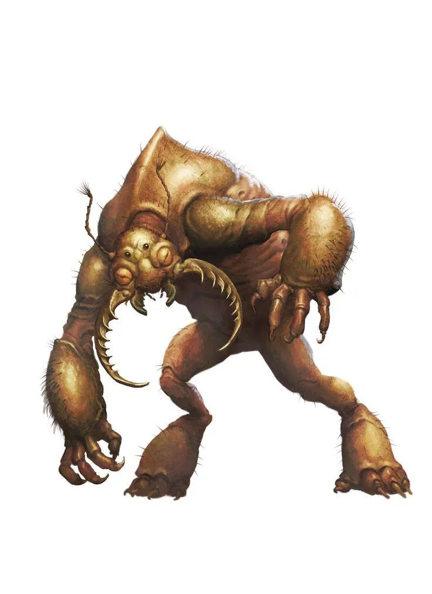

# Tribulo Brutal

## Bloco de estatísticas: Tríbulo Brutal

*Monstruosidade Grande, caótico e mau*

**Classe de Armadura** 18 (armadura natural)  
**Pontos de Vida** 93 (11d10 + 33)  
**Deslocamento** 9 m, escavação 6 m

| FOR | DES | CON | INT | SAB | CAR |
| :---: | :---: | :---: | :---: | :---: | :---: |
| 20 (+5) | 13 (+1) | 16 (+3) | 9 (–1) | 10 (+0) | 10 (+0) |

**Sentidos** visão no escuro 36 m, sentido sísmico 18 m, Percepção passiva 10  
**Idiomas** Tríbulo Brutal  
**Nível de Desafio** 5 (1.800 XP)

***Escavador***. O tríbulo brutal pode escavar através de rocha sólida com metade do seu deslocamento de escavação e deixa um túnel de 1,5 metro de largura por 2,4 metros de altura para trás.

***Olhar de Confusão***. Quando uma criatura começa seu turno a até 9 metros do tríbulo brutal e é capaz de ver os olhos do tríbulo, o tríbulo pode força-la magicamente a realizar um teste de resistência de Carisma CD 15, a não ser que o tríbulo esteja incapacitado.

Um abominável horror das profundezas da terra, o tríbulo brutal escava complexos de caverna, masmorras ou colônias do Subterrâneo em busca de comida. Aqueles sortudos o suficiente para sobreviver ao ataque do tríbulo brutal frequentemente lembram-se muito pouco do incidente, graças ao olhar de confusão do tríbulo brutal.

***Escavadores Desonestos***. Os tríbulos brutais podem escavar através da rocha sólida, formando túneis no seu caminho. A quitina dura como aço de seus corpos pode suportar os desmoronamentos, colapsos de túneis e quedas de pedras que normalmente os seguem.

Enterrando-se na parede de cavernas ou passagens, um tríbulo brutal aguarda pela passagem de criaturas do outro lado suas antenas peludas sentem qualquer movimento ao seu redor. Quando ele emerge em uma chuva de terra e pedras, sua presa desavisada vira-se para confrontar a ameaça que se aproxima – e é fascinada pelos olhos desconcertantes do tríbulo brutal, forçada a permanecer indefesa enquanto as mandíbulas do tríbulo se fecham.

***Embaralhador de Mentes***. Muitos sobreviventes de um encontro com um tríbulo brutal recordam pouco do ataque, pois o olhar de confusão do monstro embaralha suas lembranças sobre o evento. Aqueles que lutaram e mataram tríbulos brutais reconhecem os sinais. Para outros habitantes do Subterrâneo, contos terríveis de exploradores desaparecidos e destruição desenfreada falam de um inimigo desconhecido. Os tríbulos brutais assumem um estado de sobrenatural nessas histórias angustiantes, muitas das quais transmitem o mesmo aviso: quando um tríbulo brutal for avistado, já é tarde demais para escapar.

Se fracassar no teste de resistência, a criatura não pode realizar reações até o início do próximo turno dela e rola um d8 para determinar o que ela faz durante esse turno. Entre 1 e 4, a criatura não faz nada. Entre 5 e 6, a criatura não realiza nenhuma ação, mas usa todo o seu deslocamento para se mover em uma direção aleatória. Entre 7 e 8, a criatura realiza um ataque corpo-a-corpo contra uma criatura aleatória, ou não faz nada caso não haja nenhuma criatura no alcance. A não ser que esteja surpresa, uma criatura pode desviar seu olhar para evitar o teste de resistência no início do turno dela. Se a criatura o fizer, ela não poderá ver o tríbulo brutal até o início do próximo turno dela, quando ela poderá desviar o olhar novamente. Se a criatura olhar para o tríbulo nesse meio tempo, ela deve imediatamente realizar a resistência.

### Ações

***Ataques Múltiplos***. O tríbulo brutal realiza três ataques: dois com suas garras e um com suas mandíbulas.

***Garras***. *Ataque Corpo-a-Corpo com Arma*: +8 para atingir, alcance 1,5 m, um alvo. *Acerto*: 9 (1d8 + 5) de dano cortante.

***Mandíbulas***. *Ataque Corpo-a-Corpo com Arma*: +8 para atingir, alcance 1,5 m, um alvo. *Acerto*: 14 (2d8 + 5) de dano cortante.
