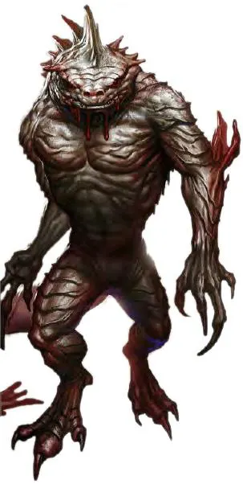

# Troglodita

Os selvagens e degenerados trogloditas escondem-se nas profundezas rasas do Subterrâneo em um constante estado de guerra contra seus vizinhos e uns contra os outros. Eles marcam as fronteiras de seus territórios com ossos partidos e caveiras, ou com pictogramas pintados com sangue ou esterco.

Talvez os mais repugnantes de todos os humanoides, os trogloditas comem qualquer coisa que possam suportar. Eles vivem na imundície. As paredes de seus lares cavernosos são manchadas com sujeira, secreções oleosas e restos de seus banquetes nojentos.

***Brutos Simplórios***. Os trogloditas tem uma cultura comunitária simples, devotada praticamente apenas a procura de comida. Muito simplórios para planejarem mais do que alguns dias no futuro, os trogloditas dependem de ataques e caçadas constantes para sobreviver. Eles tem um prazer sádico em caçar criaturas inteligentes mais fracas que eles e não mostram misericórdia com aqueles que eles capturam e trazem de volta aos seus covis para serem devorados. Os trogloditas maiores e mais resistentes lideram a caçada e tornam-se os líderes de suas tribos. Porém, se um líder mostrar qualquer fraqueza ou hesitação, os outros trogloditas o atacarão e devoraram em um frenesi.

Os trogloditas fazem pouco e constroem menos ainda, coletando suas posses de suas presas. Eles sabem o valor de armas e armaduras de metal e lutam entre si pelo direito de possuir tais itens. Uma tribo de trogloditas pode se fragmentar por brigas por uma única espada longa.

***Devotos de Laogzed***. Alguns trogloditas veneram Laogzed, um demoníaco sapo-lagarto monstruosamente gordo que dorme no Abismo. Laogzed não oferece nada em troca aos trogloditas, exceto inspiração, pois esse é o sonho de seus adoradores trogloditas, tornar-se tão gordo, bem alimentado e saciado quanto ele parece ser.

## Bloco de estatísticas: Troglodita

*Humanoide Médio (troglodita), caótico e mau*

**Classe de Armadura** 11 (armadura natural)  
**Pontos de Vida** 13 (2d8 + 4)  
**Deslocamento** 9 m

| FOR | DES | CON | INT | SAB | CAR |
| :---: | :---: | :---: | :---: | :---: | :---: |
| 14 (+2) | 10 (+0) | 14 (+2) | 6 (–2) | 10 (+0) | 6 (–2) |

**Perícias** Furtividade +2  
**Sentidos** visão no escuro 18 m, Percepção passiva 10  
**Idiomas** Troglodita  
**Nível de Desafio** 1/4 (50 XP)

***Fedor***. Qualquer criatura diferente de um troglodita que começar seu turno a 1,5 metro do troglodita deve ser bem sucedida num teste de resistência de Constituição CD 12 ou ficará envenenada até o início do seu próximo turno. Se obtiver sucesso no teste de resistência, a criatura fica imune ao fedor de todos os trogloditas por 1 hora.

***Pele de Camaleão***. O troglodita tem vantagem em testes de Destreza (Furtividade) feitos para se esconder.

***Sensibilidade à Luz Solar***. Enquanto estiver sob luz solar, o kuo-toa tem desvantagem nas jogadas de ataque, assim como em testes de Sabedoria (Percepção) relacionados a visão.

### Ações

***Ataques Múltiplos***. O troglodita realiza três ataques: um com sua mordida e dois com suas garras.

***Mordida***. *Ataque Corpo-a-Corpo com Arma*: +4 para atingir, alcance 1,5 m, um alvo. *Acerto*: 4 (1d4 + 2) de dano perfurante.

***Garra***. *Ataque Corpo-a-Corpo com Arma*: +4 para atingir, alcance 1,5 m, um alvo. *Acerto*: 4 (1d4 + 2) de dano cortante.
