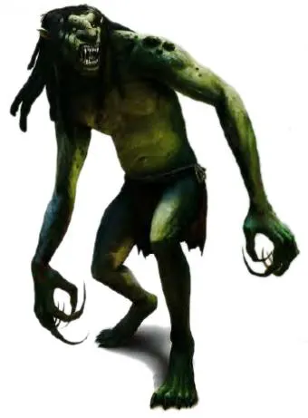

# Troll

Nascidos com aparências horrendas, os trolls comem tudo que eles puderem pegar e devorar. Eles não possuem uma sociedade para se falar, mas eles servem como mercenários a orcs, ogros, ettins, bruxas e gigantes. Como pagamento, os trolls exigem comida e tesouros. Os trolls são difíceis de se controlar, porém, fazem o que querem, mesmo quando estão lidando com criaturas mais poderosas.

***Regeneração***. Esmagar os ossos de um troll e cortar suas peles borrachudas apenas deixa o troll mais zangado. As feridas de um troll se fecham rapidamente. Se o monstro perder um braço, uma perna, ou até mesmo sua cabeça, essas partes desmembradas podem, às vezes, agir com vida própria. Um troll pode até mesmo recolocar partes do corpo decepadas, despreocupado com sua deficiência momentânea. Apenas ácido e fogo podem impedir as propriedades regenerativas da carne de um troll. Os trolls, enfurecidos, irão atacar indivíduos que estejam realizando ataques de ácido e fogo contra eles acima de todas as outras presas.

***Aberrações Troll***. Suas capacidades regenerativas fazem dos trolls especialmente suscetíveis a mutações. Apesar de incomuns, tais transformações podem resultar do que o troll fez ou do que fizeram com ele. Podem crescer duas cabeças do cepo do pescoço de um troll decapitado, enquanto que um troll que devore uma criatura feérica pode ganhar um ou mais traços dessa criatura.

> **Variação: Membros Repugnantes**
>
> Alguns trolls possuem o seguinte traço. Membros Repugnantes. Sempre que o troll sofrer, pelo menos, 15 de dano cortante de uma vez, role um d20 para determinar o que acontece com ele:
>
> **1–10**: Nada mais acontece. **11–14**: Uma perna é decepada do troll, se ele possuir quaisquer pernas restantes. **15–18**: Um braço é decepado do troll, se ele possuir quaisquer braços restantes. **19–20**: O troll é decapitado, mas ele morre apenas se não puder se regenerar. Se ele morrer, a cabeça decepada também morre.
>
> Se o troll terminar um descanso curto ou longo sem recolocar um membro ou cabeça decepado, a parte cresce novamente. Nesse momento, a parte decepada morre. Até lá, a parte decepada age na iniciativa do troll e possui sua própria ação e movimento. Uma parte decepada tem CA 13, 10 pontos de vida e o traço Regeneração do troll. Uma **perna decepada** é incapaz de atacar e tem deslocamento de 1,5 metro. Um **braço decepado** possui deslocamento 1,5 metro e pode realizar um ataque de garra no seu turno, com desvantagem na jogada de ataque, a não ser que o troll possa ver o braço e o alvo dele. Cada vez que o troll perder um braço, ele perde um ataque de garra. Se sua cabeça for decepada, o troll perde seu ataque de mordida e seu corpo fica cego, a não ser que a cabeça possa vê-lo. A **cabeça decepada** tem deslocamento de 0 metros e o traço Faro Aguçado do troll. Ela pode realizar um ataque de mordida apenas contra um alvo em seu espaço. O deslocamento do troll é reduzido à metade se uma perna for perdida. Se ele perder ambas as pernas, ele fica caído no chão. Se ele possuir ambos os braços, poderá rastejar. Com apenas um braço, ele ainda pode rastejar, mas seu deslocamento é reduzido à metade. Sem pernas e sem braços, seu deslocamento é 0 e ele não pode se beneficiar por quaisquer bônus de deslocamento.

## Bloco de estatísticas: Troll

*Gigante Grande, caótico e mau*

**Classe de Armadura** 15 (armadura natural)  
**Pontos de Vida** 84 (8d10 + 40)  
**Deslocamento** 9 m

| FOR | DES | CON | INT | SAB | CAR |
| :---: | :---: | :---: | :---: | :---: | :---: |
| 18 (+4) | 13 (+1) | 20 (+5) | 7 (–2) | 9 (–1) | 7 (–2) |

**Perícias** Percepção +2  
**Sentidos** visão no escuro 18 m, Percepção passiva 12  
**Idiomas** Gigante  
**Nível de Desafio** 5 (1.800 XP)

***Faro Aguçado***. O troll tem vantagem em testes de Sabedoria (Percepção) relacionados ao olfato.

***Regeneração***. O troll recupera 10 pontos de vida no início de cada um dos seus turnos. Se o troll sofrer dano de ácido ou fogo, esse traço não funcionará até o início do próximo turno do troll. O troll morre apenas se começar seu turno com 0 pontos de vida e não puder se regenerar.

### Ações

***Ataques Múltiplos***. O troll realiza três ataques: um com sua mordida e dois com suas garras.

***Mordida***. *Ataque Corpo-a-Corpo com Arma*: +7 para atingir, alcance 1,5 m, um alvo. *Acerto*: 7 (1d6 + 4) de dano perfurante.

***Garra***. *Ataque Corpo-a-Corpo com Arma*: +7 para atingir, alcance 1,5 m, um alvo. *Acerto*: 11 (2d6 + 4) de dano cortante.
