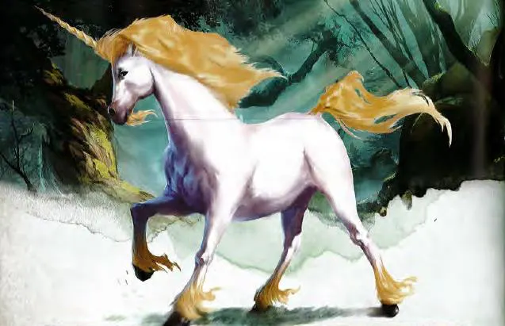

# Unicórnio

Os unicórnios vivem em florestas encantadas. Alheio aos cavalos com que se assemelha, um unicórnio é uma criatura celestial que vaga por reinos silvestres, sua forma branca cintila como a luz estelar.

A testa do unicórnio ostenta um único chifre espiralado de marfim cujo toque mágico pode curar os doentes e os feridos. Suas orelhas captam as palavras e sussurros das criaturas que compartilham seu domínio, e ele conhece a língua dos elfos e do povo silvestre. Os unicórnios permitem que criaturas de bom coração entre suas florestas para caçar ou coletar comida, mas eles mantem o mal longe de suas fronteiras. Criaturas de coração cruel raramente deixam o domínio de um unicórnio vivas.

***Guardiões Divinos***. Divindades boas colocam unicórnios no Plano Material para expulsar o mal e preservar e proteger locais sagrados. A maioria dos unicórnios protege um reino delimitado, como uma floresta encantada. Porém, os deuses às vezes enviam um unicórnio para guardar artefatos sagrados ou para proteger criaturas especificas. Quando as forças das trevas atacam um indivíduo que os deuses desejam proteger, eles enviarão esse indivíduo para a floresta de um unicórnio, onde criaturas malignas o perseguirão por sua conta e risco.

Os unicórnios frequentemente servem divindades da floresta e dos bosques, incluindo os deuses das fadas benevolentes. Apesar de todos os unicórnios terem poderes de cura naturais, alguns servem os deuses com capacidades maiores, realizando milagres normalmente reservados aos sumo sacerdotes.

***Senhores da Floresta***. A floresta de um unicórnio é um reino celestial onde nada que ocorra sob as folhas banhadas pelo sol, escapam da percepção da criatura. Um unicórnio ouve cada nota ofegante cantada pelos elfos que residem em meio às copas das árvores. Ele sente onde cada lagarta sai de seu casulo, cada folha e ramo no qual uma bela borboleta descansa suas asas cansadas.

Na floresta de um unicórnio, uma sensação de calma persevera. De lobos e raposas a pássaros, esquilos e minúsculos insetos, as criaturas do domínio de um unicórnio parecem muito mansas. Pixies, sprites, sátiros, dríades e outras fadas normalmente volúveis servem lealmente um unicórnio quando elas vivem dentro de suas florestas. Sob a proteção de um unicórnio, as criaturas se sentem seguras da ameaça da invasão da civilização e da propagação insidiosa do mal.

Um unicórnio vaga constantemente por seu domínio, movendo-se sempre cuidadosamente para não perturbar seus outros habitantes. Uma criatura pode vislumbrar a passagem do unicórnio e, de repente, não ver nada além dos bosques silvestres.

***Chifres Sagrados***. O chifre de um unicórnio é o foco do seu poder, um fragmento de magia divina forjado em marfim espiralado. Varinhas de chifres de unicórnio canalizam mágica poderoso, enquanto as armas de chifres de unicórnio golpeiam com força divina. Os magos podem fazer poções e tinta de pergaminho potentes com o pó de chifre de unicórnio, ou usá-lo como componente para rituais místicos. Porém, qualquer criatura que tenha parte, mesmo que pequena, no assassinato de um unicórnio, está suscetível de se tornar alvo de retribuição divina.

***Montarias Abençoadas***. Quando as trevas e o mal ameaçam prevalecer no mundo mortal, os deuses às vezes veem um motivo para vincular um unicórnio de montaria com um campeão. Um paladino montado em um unicórnio é um sinal de intervenção direta dos deuses nos assuntos do reino mortal. Ela é uma aliança sagrada feita para extirpar as cabeças de demônios e banir diabos de volta para os Nove Infernos.

Enquanto os tempos difíceis de trevas persistirem, o unicórnio ficará com o campeão, com seu chifre brilhando intensamente para afastar a noite. Porém, se o campeão dos deuses cair em desgraça ou se virar contra a causa da justiça e do bem, o unicórnio partirá, nunca mais retornando.

### O Covil do Unicórnio

O covil de um unicórnio pode ser uma ruína antiga encoberta por vinhas, uma clareira brumosa envolta por poderosos carvalhos, o topo de uma colina coberto de flores vivido com borboletas ou algum outro local sereno da floresta.

### Efeitos Regionais

Transformado pela presença celestial da criatura, o domínio de um unicórnio pode incluir qualquer dos seguintes efeitos mágicos:

- Incêndios a céu aberto de natureza não-mágica são extintos dentro do domínio do unicórnio. Tochas e fogueiras recusam-se a queimar, mas lanternas fechadas não são afetadas.
- As criaturas nativas do domínio do unicórnio tem mais facilidade para se esconder; elas tem vantagem em todos os testes de Destreza (Furtividade) feitos para se esconder.
- Quando uma criatura de tendência boa conjura uma magia ou usa um efeito mágico que faz com que outra criatura de tendência boa recupere pontos de vida, o alvo recupera o valor máximo de pontos de vida possível para essa magia ou efeito.
- Maldições afetando qualquer criatura de tendência boa são suprimidas.

Se o unicórnio morrer, esses efeitos terminam imediatamente.

## Bloco de estatísticas: Unicórnio

*Celestial Grande, leal e bom*

**Classe de Armadura** 12  
**Pontos de Vida** 67 (9d10 + 18)  
**Deslocamento** 15 m

| FOR | DES | CON | INT | SAB | CAR |
| :---: | :---: | :---: | :---: | :---: | :---: |
| 18 (+4) | 14 (+2) | 15 (+2) | 11 (+0) | 17 (+3) | 16 (+3) |

**Imunidade a Dano** veneno  
**Imunidade a Condição** enfeitiçado, envenenado, paralisado  
**Sentidos** visão no escuro 18 m, Percepção passiva 13  
**Idiomas** Celestial, Élfico, Silvestre, telepatia 18 m  
**Nível de Desafio** 5 (1.800 XP)

***Armas Mágicas***. Os ataques com arma do unicórnio são mágicos.

***Conjuração Inata***. A habilidade de conjuração de um unicórnio é Carisma (CD de resistência de magia 14). Ele pode conjurar, inatamente, as seguintes magias, sem necessidade de quaisquer componentes:

À vontade: *detectar bem e mal, druidismo, passos sem pegadas* 1/dia cada: *acalmar emoções, constrição, dissipar o bem e mal*

***Investida***. Se o unicórnio se mover, pelo menos, 6 metros em linha reta até um alvo e então atingi-lo com seu ataque de chifre no mesmo turno, o alvo sofre 9 (2d8) de dano perfurante extra. Se o alvo for uma criatura, ele deve ser bem sucedido num teste de resistência de Força CD 15 ou será derrubado no chão.

***Resistência à Magia***. O unicórnio possui vantagem nos testes de resistência contra magias e outros efeitos mágicos.

### Ações

***Ataques Múltiplos***. O unicórnio realiza dois ataques: um com seus cascos e um com seu chifre.

***Cascos***. *Ataque Corpo-a-Corpo com Arma*: +7 para atingir, alcance 1,5 m, um alvo. *Acerto*: 11 (2d6 + 4) de dano de concussão.

***Chifre***. *Ataque Corpo-a-Corpo com Arma*: +7 para atingir, alcance 1,5 m, um alvo. *Acerto*: 8 (1d8 + 4) de dano perfurante.

***Toque Curativo (3/Dia)***. O unicórnio toca outra criatura com seu chifre. O alvo recupera magicamente 11 (2d8 + 2) pontos de vida. Além disso, o toque remove todas as doenças e neutraliza todos os venenos afligindo o alvo.

***Teletransporte***. O unicórnio magicamente teletransporta a si e até mais três criaturas voluntárias, que ele possa ver a até 1,5 metros dele, junto com todo o equipamento que estejam vestindo ou carregando, para um local que seja familiar ao unicórnio a até 1,5 quilômetro de distância.

### Ações Lendárias

O unicórnio pode realizar 3 ações lendárias, escolhidas dentre as opções abaixo. Apenas uma ação lendária pode ser usada por vez e apenas no final do turno de outra criatura. O unicórnio recupera as ações lendárias gastas no começo do turno dele.

**Cascos**. O unicórnio realiza um ataque com seus cascos.  
**Escudo Cintilante (Custa 2 Ações)**. O unicórnio cria um campo mágico cintilante em volta de si mesmo ou de outra criatura que ele possa ver, a até 18 metros dele. O alvo recebe +2 de bônus na CA até o final do próximo turno do unicórnio.  
**Curar-se (Custa 3 Ações)**. O unicórnio recupera magicamente 11 (2d8 + 2) pontos de vida.
