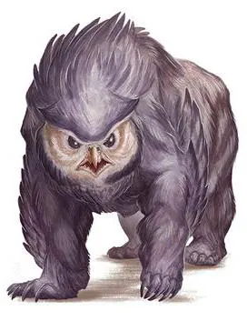

# Urso-Coruja

O guincho de um urso-coruja ecoa pelos vales escuros e florestas tenebrosas, penetrando a noite calma para anunciar a morte de sua presa. Penas cobrem a pelagem grossa do seu corpo ursino e as pupilas límpidas de seus grandes olhos redondos fitam furiosamente de sua cabeça de coruja.

***Ferocidade Mortal***. A reputação dos ursos-coruja por sua ferocidade, agressividade, obstinação e mau humor, tornam-nos um dos mais temidos predadores do ambiente selvagem. Existe muito pouco, praticamente nada, que um urso-coruja faminto tema. Até mesmo monstros superiores ao urso-coruja em tamanho e força evitam cruzar com eles, pois essas criaturas não se importa com a força superior de um adversário, atacando sem provocação.

***Predadores Excepcionais***. Um urso-coruja emerge de sua toca por volta do pôr do sol e caça nas horas mais escuras da noite, piando ou guinchando para declarar seu território, para procurar um companheiro ou para apavorar as presas no seu território de caça. Estas são tipicamente florestas familiares ao urso-coruja, densas o suficiente para limitar as rotas de fuga de suas presas.

Um urso-coruja faz sua toca em uma caverna ou ruína repleta de ossos de suas presas. Ele larga mortos parcialmente devorados atrás da sua toca, armazenando porções de carcaças entre as rochas, arbustos e árvores ao redor. O cheiro de sangue e carne apodrecendo fica mais forte próximo do covil de um urso-coruja, atraindo coletores e assim, juntando mais presas.

Os ursos-coruja caçam sozinhos ou em casais. Se as presas forem abundantes, uma família de ursos-coruja pode permanecer junta por mais tempo que o necessário para criar seus filhotes. Do contrário, eles se separam assim que os jovens estiverem aptos a caçar.

***Companheiros Selvagens***. Apesar de serem mais inteligentes que a maioria dos animais, os ursos-coruja são difíceis de domesticar. Porém, com tempo, comida e sorte suficientes, uma criatura inteligente pode treinar um urso-coruja a reconhece-lo como seu mestre, fazendo dele um guardião resoluto ou uma montaria rápida e resistente. Povos de assentamentos fronteiriços remotos tiveram sucesso até em fazer corridas de ursos-coruja, mas os espectadores frequentemente apostam em qual urso-coruja atacará seu domador como apostariam em qual iria chegar na linha de chegada primeiro.

Comunidades élficas encorajam ursos-coruja a fazerem suas tocas debaixo de suas vilas nas copas das árvores, usando as bestas como uma defesa natural durante a noite. Os hobgoblins apreciam ursos-coruja como bestas de guerra e os gigantes da colina e gigantes do gelo, às vezes, mantem ursos-coruja como animais de estimação. Um urso-coruja faminto pode aparecer numa arena gladiatória, impiedosamente eviscerando e devorando seus adversários perante uma audiência sedenta por sangue.

***Origem dos Ursos-Coruja***. Estudiosos debatem há muito tempo sobre as origens do urso-coruja. A teoria mais comum é que um mago demente criou a primeira espécime ao cruzar uma coruja gigante com um urso. Porém, elfos veneráveis dizem conhecer essas criaturas a milhares de anos e algumas fadas insistem que os ursos-coruja sempre existiram em Faéria.

## Bloco de estatísticas: Urso-Coruja

*Monstruosidade Grande, imparcial*

**Classe de Armadura** 13 (armadura natural)  
**Pontos de Vida** 59 (7d10 + 21)  
**Deslocamento** 12 m

| FOR | DES | CON | INT | SAB | CAR |
| :---: | :---: | :---: | :---: | :---: | :---: |
| 20 (+5) | 12 (+1) | 17 (+3) | 3 (–4) | 12 (+1) | 7 (–2) |

**Perícias** Percepção +3  
**Sentidos** visão no escuro 18 m, Percepção passiva 13  
**Idiomas** –  
**Nível de Desafio** 3 (700 XP)

***Visão e Faro Aguçados***. O urso-coruja tem vantagem em testes de Sabedoria (Percepção) relacionados à visão e ao olfato.

### Ações

***Ataques Múltiplos***. O urso-coruja realiza dois ataques: um com sua bicada e um com suas garras.

***Bicada***. *Ataque Corpo-a-Corpo com Arma*: +7 para atingir, alcance 1,5 m, um alvo. *Acerto*: 10 (1d10 + 5) de dano perfurante.

***Garras***. *Ataque Corpo-a-Corpo com Arma*: +7 para atingir, alcance 1,5 m, um alvo. *Acerto*: 14 (2d8 + 5) de dano cortante.
