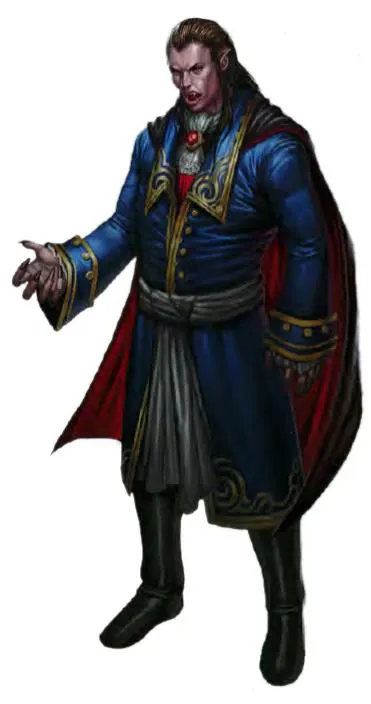
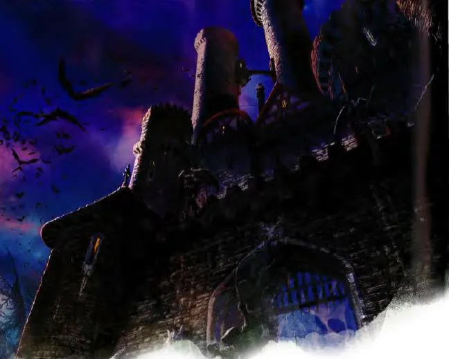
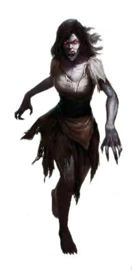

# Vampiros

Desperto para uma noite interminável, os vampiros tem fome pela vida que perderam e saciam essa fome ao beber o sangue dos vivos. Os vampiros abominam a luz solar, pois seu toque os queima. Eles nunca projetam sombras ou reflexos e qualquer vampiro que deseje se mover sem ser notado entre os vivos, se mantem na escuridão e longe de superfícies reflexivas.

***Desejos Sombrios***. Se um vampiro mantem ou não quaisquer lembranças de sua vida anterior, seus apegos emocionais murcharam enquanto sentimentos que outrora foram puros se distorceram pela morte-vida. Amor se tornou uma obsessão compulsiva, enquanto amizade se tornou inveja amarga. No lugar de emoções, os vampiros perseguem símbolos físicos do seus desejos, assim sendo, um vampiro buscando amor irá se fixar em uma bela jovem. Uma criança pode se tornar m objeto de fascínio para um vampiro obcecado com a juventude e potencial. Outros cercam-se com artes, livros e itens sinistros como instrumentos de tortura ou troféus de criaturas que eles mataram.

***Nascido da Morte***. A maioria das vítimas de um vampiro se tornam crias vampíricas – criaturas vorazes com uma sede vampírica por sangue, mas sob o controle do vampiro que as criou. Se um vampiro verdadeiro permitir que uma cria sugue o sangue de seu corpo, a cria se transformará em um vampiro verdadeiro não estando mais sob controle do seu mestre. Poucos vampiros estão dispostos a abrir mão de seu controle dessa maneira. As crias vampíricas tornam-se livre quando seu criador morre.

***Preso a Cova***. Cada vampiro permanece preso a seu caixão, cripta ou túmulo, onde ele deve descansar durante o dia. Se um vampiro não tiver um enterro formal, ele deve descansar debaixo de dois palmos de terra no local de sua transição para a morte-vida. Um vampiro pode mover seu local de enterro ao transportar seu caixão ou uma quantidade significativa de terra do túmulo para outro local. Alguns vampiros criam diversos locais de descanso dessa forma.

***Natureza Morta-Viva***. Nem um vampiro nem uma cria vampírica precisam respirar.

> **Personagens de Jogadores Como Vampiros**
>
> As estatísticas de jogo de um personagem de jogador transformado em vampiro não mudam, exceto os valores de Força, Destreza e Constituição dele que se tornam 18, se já não forem maiores. Além disso, o personagem ganha as resistências a dano, visão no escuro, traços e ações do vampiro. As jogadas de ataque e dano dos ataques do vampiro são baseados em Força. A CD de Enfeitiçar é 8 + o bônus de proficiência do vampiro + seu modificador de Carisma. A tendência do personagem muda para leal e mau e o Mestre pode tomar controle do personagem até o vampirismo ser revertido com a magia *desejo* ou o personagem ser morto e trazido de volta à vida.

> **Strahd Von Zarovich**
>
> Um pensador brilhante e guerreiro competente em vida, Strahd von Zarovich lutou em incontáveis batalha por seu povo. Quando a guerra e matança finalmente arrancaram sua juventude e força, ele se instalou no remoto vale de Barovia e construiu um castelo no topo de um pináculo, de onde pudesse observar suas terras. Seu irmão Sergei, veio viver com ele no Castelo Ravenloft, tornando-se o conselheiro de Strahd e seu companheiro constante. Em seu irmão, Strahd viu tudo que havia perdido. Sergei era belo e jovem, enquanto Strahd havia se tornado velho e enrugado. O ressentimento abalou a relação deles, eventualmente se tornando em ódio. A amada de Strahd, Tatyana, o abandonou por Sergei, com quem prometeu se casar. Em uma tentativa desesperada para ganhar o coração de Tatyana, Strahd fez um pacto com poderes trevosos que o fizeram imortal. No casamento de Sergei e Tatyana, ele confrontou seu irmão e o matou. Tatyana fugiu e se atirou dos muros de Ravenloft. Os guardas de Strahd, vendo-o como um monstro, atiraram nele com flechas. Mas ele não morreu. Ele se tornou um vampiro – o primeiro vampiro, de acordo com muitos sábios. No século seguinte a sua transformação, o desejo de Strahd por vida e juventude só crescia. Ele permanece em seu castelo sombrio, amaldiçoando os vivos por roubarem o que ele perdeu, nunca admitindo sua culpa na tragédia que criou.

### O Covil do Vampiro

Um vampiro escolhe um local grande, porém ainda defensável para seu covil, como um castelo, mansão fortificada ou abadia murada. Ele se esconde em seu caixão em uma cripta subterrânea ou câmara guardada por crias vampíricas ou outras criaturas leais da noite.

### Efeitos Regionais

A região em volta do covil de um vampiro é distorcida pela presença sobrenatural da criatura, criando qualquer dos seguintes efeitos:

- Ocorre um aumento notável nas populações de morcegos, ratos e lobos na região.
- As plantas a até 150 metros do covil parecem anormalmente secas e às vezes parecem se mover com se estivessem vivas.
- Uma névoa rasteira encobre o solo a até 150 metros do covil do vampiro. A névoa ocasionalmente assume formas assustadoras, como de garras rastejando e serpentes se contorcendo.

Se o vampiro for destruído, esses efeitos terminam após 2d6 dias.

## Bloco de estatísticas: Vampiro

*Morto-vivo Médio (metamorfo), leal e mau*

**Classe de Armadura** 16 (armadura natural)  
**Pontos de Vida** 144 (17d8 + 68)  
**Deslocamento** 9 m

| FOR | DES | CON | INT | SAB | CAR |
| :---: | :---: | :---: | :---: | :---: | :---: |
| 18 (+4) | 18 (+4) | 18 (+4) | 17 (+3) | 15 (+2) | 18 (+4) |

**Testes de Resistência** Des +9, Sab +7, Car +9  
**Perícias** Furtividade +9, Percepção +7  
**Resistência a Dano** necrótico; concussão, cortante e perfurante de ataques não-mágicos  
**Sentidos** visão no escuro 36 m, Percepção passiva 17  
**Idiomas** os idiomas que conhecia em vida  
**Nível de Desafio** 13 (10.000 XP)

***Fraquezas Vampíricas***. O vampiro tem as seguintes fraquezas: *Estaca no Coração*. Se uma arma perfurante feita de madeira for enfiada no coração de um vampiro enquanto ele estiver incapacitado no seu local de descanso, o vampiro fica paralisado até a estaca ser removida. *Ferido por Água Corrente*. O vampiro sofre 20 de dano de ácido se terminar seu turno em água corrente. *Hipersensibilidade à Luz Solar*. O vampiro sofre 20 de dano radiante quando começa seu turno sob luz solar. Enquanto estiver sob luz solar, ele tem desvantagem nas jogadas de ataque e testes de habilidade. *Proibição*. O vampiro não pode entrar numa residência sem ser convidado por um dos seus ocupantes.

***Metamorfo***. Se o vampiro não estiver sob luz solar ou água corrente, ele pode usar sua ação para se metamorfosear em um morcego Miúdo, em uma nuvem de neblina Média, ou voltar para sua forma verdadeira. Enquanto estiver na forma de morcego, o vampiro não pode falar, seu deslocamento de caminhada é de 1,5 metro e ele tem deslocamento de voo de 9 metros. Suas estatísticas, além do seu tamanho e deslocamento, não se alteram. Tudo que ele estiver vestindo é transformado com ele, mas nada que esteja sendo carregado é. Ele reverte para sua forma verdadeira se morrer. Enquanto estiver na forma de neblina, o vampiro não pode realizar quaisquer ações, falar ou manipular objetos. Ele não tem peso, ele tem deslocamento de voo de 6 metros, pode planar e pode entrar no espaço de criaturas hostis e ficar parado nele. Além disso, se ar puder passar por um espaço, a neblina também poderá sem se espremer e ela não pode passar através da água. Ele tem vantagem em testes de resistência de Força, Destreza e Constituição e é imune a todos os danos não-mágicos, exceto o dano que ele sofre da luz solar.

***Neblina de Escapada***. Quando cair a 0 pontos de vida fora de seu local de descanso, o vampiro se transforma em uma nuvem de neblina (como no traço Metamorfo) ao invés de cair inconsciente, considerando que ele não esteja sob luz solar ou água corrente. Se ele não puder se transformar, ele é destruído. Enquanto estiver com 0 pontos de vida na forma de neblina, ele não pode reverter para sua forma de vampiro e deve alcançar seu local de descanso dentro de 2 horas ou será destruído. Uma vez em seu local de descanso, ele reverte para sua forma de vampiro. Ele então fica paralisado até recuperar, pelo menos, 1 ponto de vida. Após 1 hora gasta em seu local de descanso com 0 pontos de vida, ele recupera 1 ponto de vida.

***Escalada Aracnídea***. O vampiro pode escalar superfícies difíceis, incluindo andar de cabeça para baixo em tetos, sem precisar realizar um teste de habilidade.

***Regeneração***. O vampiro recupera 20 pontos de vida no início de cada um dos seus turnos se ele tiver, pelo menos, 1 ponto de vida e não esteja sob luz solar ou água corrente. Se o vampiro sofrer dano radiante ou dano de água benta, esse traço não funcionará até o início do próximo turno do vampiro.

***Resistência Lendária (3/Dia)***. Se o vampiro falhar em um teste de resistência, ele pode escolher obter sucesso, no lugar.

### Ações

***Ataques Múltiplos (Forma de Vampiro Apenas)***. O vampiro realiza dois ataques, apenas um deles pode ser um ataque de mordida.

***Golpe Desarmado (Forma de Vampiro Apenas)***. *Ataque Corpo-* *a-Corpo com Arma*: +9 para atingir, alcance 1,5 m, uma criatura. *Acerto*: 8 (1d8 + 4) de dano de concussão. Ao invés de causar dano, o vampiro pode agarrar o alvo (CD 18 para escapar)

***Mordida (Forma de Morcego ou Vampiro Apenas)***. *Ataque* *Corpo-a-Corpo com Arma*: +9 para atingir, alcance 1,5 m, uma criatura voluntária ou uma criatura agarrada pelo vampiro, incapacitada ou impedida. *Acerto*: 7 (1d6 + 4) de dano perfurante mais 10 (3d6) de dano necrótico. O máximo de pontos de vida do alvo é reduzido numa quantidade igual ao dano necrótico sofrido e o vampiro recupera uma quantidade de pontos de vida igual. A redução dura até o alvo terminar um descanso longo. O alvo morre se esse efeito reduzir seu máximo de pontos de vida a 0. Um humanoide morto dessa forma e depois enterrado no solo, ergue-se na noite seguinte como uma cria vampírica sob controle do vampiro.

***Enfeitiçar***. O vampiro afeta um humanoide que ele possa ver, a até 9 metros dele. Se o alvo puder ver o vampiro, ele deve ser bem sucedido num teste de resistência de Sabedoria CD 17 contra essa mágica, ou ficará enfeitiçado pelo vampiro. O alvo enfeitiçado considera o vampiro um amigo confiável a ser atendido e protegido. Apesar do alvo não estar sob o controle do vampiro, ele atende os pedidos do vampiro ou age da forma mais favorável que puder e ele é um alvo voluntário para o ataque de mordida do vampiro. Toda vez que o vampiro ou os companheiros dele fizerem algo nocivo com o alvo, ele poderá repetir o teste de resistência, terminando o efeito sobre si com um sucesso. Do contrário, o efeito dura por 24 horas ou até o vampiro ser destruído, estive em um plano de existência diferente do alvo ou usar uma ação bônus para terminar o efeito.

***Filhos da Noite (1/Dia)***. O vampiro magicamente convoca 2d4 enxames de morcegos ou ratos, considerando que o sol não esteja erguido. Quando estiver ao ar livre, ele pode convocar 3d6 lobos no lugar. As criaturas convocadas chegam em 1d4 rodadas, agindo como aliadas do vampiro e obedecendo seus comandos falados. As bestas permanecem por 1 hora, até o vampiro morrer ou até o vampiro dispensa-las com uma ação bônus.

### Ações Lendárias

O vampiro pode realizar 3 ações lendárias, escolhidas dentre as opções abaixo. Apenas uma ação lendária pode ser usada por vez e apenas no final do turno de outra criatura. O vampiro recupera as ações lendárias gastas no começo do turno dele.

**Movimento**. O vampiro se move até seu deslocamento sem provocar ataques de oportunidade.  
**Golpe Desarmado**. O vampiro realiza um golpe desarmado.  
**Mordida (Custa 2 Ações)**. O vampiro realiza um ataque de mordida.

## Bloco de estatísticas: Cria Vampírica

*Morto-vivo Médio (metamorfo), neutro e mau*

**Classe de Armadura** 15 (armadura natural)  
**Pontos de Vida** 82 (11d8 + 33)  
**Deslocamento** 9 m

| FOR | DES | CON | INT | SAB | CAR |
| :---: | :---: | :---: | :---: | :---: | :---: |
| 16 (+3) | 16 (+3) | 16 (+3) | 11 (+0) | 11 (+0) | 12 (+1) |

**Testes de Resistência** Des +6, Sab +3  
**Perícias** Furtividade +6, Percepção +3  
**Resistência a Dano** necrótico; concussão, cortante e perfurante de ataques não-mágicos  
**Sentidos** visão no escuro 18 m, Percepção passiva 13  
**Idiomas** os idiomas que conhecia em vida  
**Nível de Desafio** 5 (1.800 XP)

***Fraquezas Vampíricas***. A cria tem as seguintes fraquezas: *Estaca no Coração*. Se uma arma perfurante feita de madeira for enfiada no coração de uma cria enquanto ela estiver incapacitada no seu local de descanso, a cria fica paralisada até a estaca ser removida. *Ferido por Água Corrente*. A cria sofre 20 de dano de ácido se terminar seu turno em água corrente. *Hipersensibilidade à Luz Solar*. A cria sofre 20 de dano radiante quando começa seu turno sob luz solar. Enquanto estiver sob luz solar, ela tem desvantagem nas jogadas de ataque e testes de habilidade.

### Variação: Guerreiros e Conjuradores Vampiros

Alguns vampiros possuem treinamento marcial e experiência no campo de batalha. Um **vampiro guerreiro** vestindo uma armadura de placas (CA 18) e empunhando uma espada grande tem nível de desafio 15 (13.000 XP) e a seguinte opção de ação adicional:

***Ataques Múltiplos***. O vampiro realiza dois ataques com espada grande.

***Espada Grande***. *Ataque Corpo-a-Corpo com Arma*: +9 para atingir, alcance 1,5 m, um alvo. *Acerto*: 11 (2d6 + 4) de dano cortante.

Alguns vampiros são praticantes de artes arcanas. Um **vampiro**

**conjurador** tem nível de desafio 15 (13.000 XP) e o seguinte traço:

***Conjuração***. O vampiro é um conjurador de 9° nível. Sua habilidade de conjuração é Inteligência (CD de resistência de magia 16, +8 para atingir com ataques com magia). Ele possui as seguintes magias de mago preparadas:

Truques (à vontade): *mãos mágicas, prestidigitação, raio de gelo* 1° nível (4 espaços): *compreender idiomas, névoa obscurecente,* *sono* 2° nível (3 espaços): *detectar pensamentos, lufada de vento,* *reflexos* 3° nível (3 espaços): *animar os mortos, dificultar detecção, rogar* *maldição* 4° nível (3 espaços): *invisibilidade maior, malogro* 5° nível (1 espaços): *dominar pessoa*

*Proibição*. A cria não pode entrar numa residência sem ser convidado por um dos seus ocupantes.

***Escalada Aracnídea***. A cria pode escalar superfícies difíceis, incluindo andar de cabeça para baixo em tetos, sem precisar realizar um teste de habilidade.

***Regeneração***. A cria recupera 10 pontos de vida no início de cada um dos seus turnos se ela tiver, pelo menos, 1 ponto de vida e não esteja sob luz solar ou água corrente. Se a cria sofrer dano radiante ou dano de água benta, esse traço não funcionará até o início do próximo turno da cria.

### Ações

***Ataques Múltiplos***. A cria realiza dois ataques, apenas um deles pode ser um ataque de mordida.

***Garras***. *Ataque Corpo-a-Corpo com Arma*: +6 para atingir, alcance 1,5 m, uma criatura. *Acerto*: 8 (2d4 + 4) de dano cortante. Ao invés de causar dano, o vampiro pode agarrar o alvo (CD 13 para escapar)

***Mordida***. *Ataque Corpo-a-Corpo com Arma*: +6 para atingir, alcance 1,5 m, uma criatura voluntária ou uma criatura agarrada pela cria, incapacitada ou impedida. *Acerto*: 6 (1d6 + 3) de dano perfurante mais 7 (2d6) de dano necrótico. O máximo de pontos de vida do alvo é reduzido numa quantidade igual ao dano necrótico sofrido e a cria recupera uma quantidade de pontos de vida igual. A redução dura até o alvo terminar um descanso longo. O alvo morre se esse efeito reduzir seu máximo de pontos de vida a 0.
