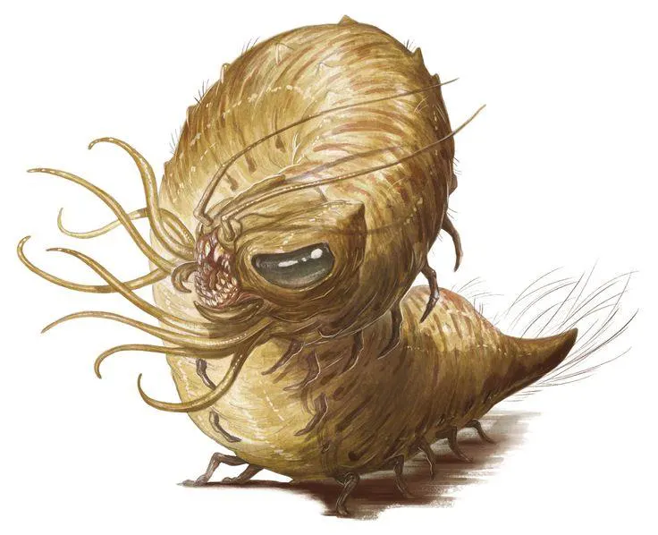

# Verme da Carniça

Os vermes da carniça chafurdam na carne podre de carcaças e devoram os ossos viscosos que restarem. Eles atacam agressivamente qualquer criatura que invada seus territórios ou perturbem seu banquete.

***Comedores de Carniça***. Um verme da carniça segue o cheiro da morte até sua comida, mas ele prefere não competir com outros carniceiros. Essas criaturas imundas esgueiram-se em territórios onde a morte é abundante e outros comedores de carniça tenham mobilidade limitada. Cavernas, esgotos, masmorras e florestas pantanosas são seus covis favoritos, mas os vermes da carniça também vão para campos de batalha e cemitérios.

Um verme da carniça perambula ao caçar, com seus tentáculos sondando o ar para cheirar o sangue ou a podridão. Em túneis ou ruínas, os vermes da carniça correm pelo teto ao se moverem em direção da comida. Dessa forma, eles evitam o contato com limos, otyughs e outros habitantes perigosos da escuridão, até mesmo surpreendendo um alimento em potencial que não pense em olhar para cima.

***Predadores Pacientes***. Quando está escuridão subterrânea ou enquanto estiver caçando à noite, a luz sinaliza uma refeição em potencial. Um verme da carniça pode seguir uma fonte de luz à distância por horas, esperando sentir o cheiro de sangue. Independentemente de seu grande tamanho, os vermes da carniça também podem facilmente preparar emboscada ao esperar em cantos cegos por presas que vem até eles.

Quando confrontado com presas em potencial ou intrusos, um verme da carniça deixa seu veneno fazer o trabalho. Uma vez que a vítima fique rígida com a paralisia, o verme da carniça agarra-a com seus tentáculos e a arrasta para uma saliência elevada ou uma passagem isolada, onde ele possa matá-la em segurança. O monstro então volta a patrulhar seu território enquanto espera sua refeição apodrecer.

## Bloco de estatísticas: Verme da Carniça

*Monstruosidade Grande, imparcial*

**Classe de Armadura** 13 (armadura natural)  
**Pontos de Vida** 51 (6d10 + 18)  
**Deslocamento** 9 m, escalada 9 m

| FOR | DES | CON | INT | SAB | CAR |
| :---: | :---: | :---: | :---: | :---: | :---: |
| 14 (+2) | 13 (+1) | 16 (+3) | 1 (–5) | 12 (+1) | 5 (–3) |

**Perícias** Percepção +3  
**Sentidos** visão no escuro 18 m, Percepção passiva 13  
**Idiomas** –  
**Nível de Desafio** 2 (450 XP)

***Faro Aguçado***. O verme tem vantagem em testes de Sabedoria (Percepção) relacionados ao olfato.

***Escalada Aracnídea***. O verme pode escalar superfícies difíceis, incluindo andar de cabeça para baixo em tetos, sem precisar realizar um teste de habilidade.

### Ações

***Ataques Múltiplos***. O verme realiza dois ataques: um com seus tentáculos e um com sua mordida.

***Tentáculos***. *Ataque Corpo-a-Corpo com Arma*: +4 para atingir, alcance 3 m, uma criatura. *Acerto*: 4 (1d4 + 2) de dano de veneno e o alvo deve ser bem sucedido num teste de resistência de Constituição CD 13 ou ficará envenenado por 1 minuto. Até esse veneno acabar, o alvo ficará paralisado. O alvo pode repetir o teste de resistência no final de cada um dos turnos dele, terminando o envenenamento sobre si com um sucesso.

***Mordida***. *Ataque Corpo-a-Corpo com Arma*: +4 para atingir, alcance 1,5 m, um alvo. *Acerto*: 7 (2d4 + 2) de dano perfurante.
