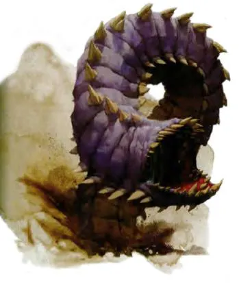

# Verme Púrpura

O gigantesco monstro escavador conhecido como verme púrpura aterroriza as criaturas do Subterrâneo enquanto mastiga através da rocha sólida em perseguição de sua presa. Como uma força irracional e voraz da natureza, essa criatura considera tudo que encontra como comida.

***Caçadores Famintos***. Barulhos altos atraem os vermes púrpuras, que são conhecidos por interromper batalhas subterrâneas e partir cidades subterrâneas buscando presas. As civilizações subterrâneas dos drow, duergar e devoradores de mentes mantem proteções especiais em volta de suas colônias para deter esses monstros.

Apesar de serem mais comuns no Subterrâneo, vermes púrpuras são frequentemente vistos na superfície do mundo em terras rochosas e montanhosas. A bocarra do verme púrpura é grande o suficiente para engolir um cavalo inteiro e nenhuma criatura está a salvo de sua fome. Ele rasteja para a frente ao ritmicamente comprimir e expandir seu corpo, pegando outros habitantes do Subterrâneo de surpresa com a velocidade que avança.

***Espólios do Verme***. Quando um verme púrpura escava o solo, ele consome terra e pedras, enquanto ele abri passagem e constantemente excreta. Metais e gemas preciosos podem então ser encontrados dentro dos corpos de vermes púrpuras, que são alvos de caçadores de tesouros particularmente bravos e imprudentes.

Um verme púrpura enterrado constantemente cria novos túneis através do Subterrâneo, que são rapidamente usados por outras criaturas como corredores e rodovias. Já que um verme púrpura raramente volta aos seus próprios túneis, tais passagens são um bom lugar para evitar esses monstros. Áreas ricas em presas rapidamente ficam entrelaçadas com um complexo sistema de túneis resultante da caçada de diversos vermes juntos.

## Bloco de estatísticas: Verme Púrpura

*Monstruosidade Imensa, imparcial*

**Classe de Armadura** 18 (armadura natural)  
**Pontos de Vida** 247 (15d20 + 90)  
**Deslocamento** 15 m, escavação 9 m

| FOR | DES | CON | INT | SAB | CAR |
| :---: | :---: | :---: | :---: | :---: | :---: |
| 28 (+9) | 7 (–2) | 22 (+6) | 1 (–5) | 8 (–1) | 4 (–3) |

**Testes de Resistência** Con +11, Sab +4  
**Sentidos** percepção às cegas 9 m, sentido sísmico 18 m, Percepção passiva 9  
**Idiomas** –  
**Nível de Desafio** 15 (13.000 XP)

***Escavador***. O verme púrpura pode escavar através de rocha sólida com metade do seu deslocamento de escavação e deixa um túnel de 3 metros de diâmetro para trás.

### Ações

***Ataques Múltiplos***. O verme realiza dois ataques: um com sua mordida e um com seu ferrão.

***Mordida***. *Ataque Corpo-a-Corpo com Arma*: +14 para atingir, alcance 3 m, um alvo. *Acerto*: 22 (3d8 + 9) de dano perfurante. Se o alvo for uma criatura Grande ou menor, ele deve ser bem sucedido num teste de resistência de Destreza CD 19 ou será engolido pelo verme. Uma criatura engolida estará cego e impedido, ela terá cobertura total contra ataques e outros efeitos de fora do verme e sofre 21 (6d6) de dano ácido no começo de cada turno do verme. Se o verme sofrer 30 de dano ou mais em um único turno por uma criatura engolida, o verme deve ser bem sucedido num teste de resistência de Constituição CD 21 no final desse turno ou regurgitará todas as criaturas engolidas, que cairão em um espaço a até 3 metros do verme. Se o verme morrer, uma criatura engolida não estará mais impedida por ele e poderá escapar do corpo usando 6 metro de movimento, estando caída ao sair.

***Ferrão de Cauda***. *Ataque Corpo-a-Corpo com Arma*: +14 para atingir, alcance 3 m, um alvo. *Acerto*: 19 (3d6 + 9) de dano perfurante e o alvo deve realizar um teste de resistência de Constituição CD 19, sofrendo 42 (12d6) de dano de veneno se fracassar na resistência, ou metade desse dano caso obtenha sucesso.
