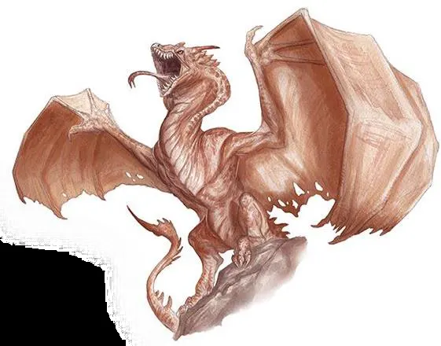

# Wyvern

Viajantes nas terras selvagens, às vezes, olha para os céus e veem a forma alada escura de um wyvern carregando uma presa. Esses primos dos grandes dragões caçam nas mesmas florestas densas e cavernas que os de seu tipo. A aparição deles envia ondas de alerta através das fronteiras da civilização.

Um wyvern possui duas pernas escamadas, asas de couro e uma cauda sinuosa com sua arma mais potente: um ferrão venenoso. O veneno no ferrão de um wyvern pode matar uma criatura em segundos. Extremamente potente, o veneno de um wyvern queima na corrente sanguínea de sua vítima, desintegrando veias e artérias no caminho até o coração. Mesmo sendo tão mortais quanto os wyverns podem ser, caçadores e aventureiros frequentemente rastreiam-nos para adquirir seu veneno, que é usado em componentes alquímicos e para ser embebido em armas.

***Caçadores Aéreos***. Um wyvern não luta no solo, a não ser que não possa alcançar sua presa de outro modo, ou se ele tiver sido atraído para uma posição onde o combate aéreo não é uma opção. Se for forçado em um confronto no solo, um wyvern se esgueira, mantendo seu ferrão posicionado acima de sua cabeça enquanto assobia e rosna.

***Agressivos e Descuidados***. Um wyvern só recusa de um ataque a suas presas se estiver gravemente ferido, ou caso sua presa escapar tempo suficiente para que outra refeição em potencial mais fácil apareça. Se ele encurralar uma criatura em um lugar pequeno demais para entrar, o wyvern aguardará onde a presa se esconde, atacando com seu ferrão sempre que a oportunidade permitir.

Apesar de terem mais astucia que as bestas ordinárias, os wyverns não tem a inteligência de seus primos dracônicos. Assim sendo, as criaturas que mantem sua compostura enquanto um wyvern as caça do ar, podem frequentemente iludi-lo ou engana-lo. Os wyverns percorrem um caminho direto até sua presa, sem se preocupar com possíveis emboscadas.

***Wyverns Treinados***. Um wyvern pode ser treinado para ser usado como montaria, mas fazê-lo representa uma dificuldade e desafio mortal. Criar um desde filhote garante os melhores resultados. Porém, o temperamento violento de um wyvern já custou muitas vidas de aspirantes a mestre.

## Bloco de estatísticas: Wyvern

*Dragão Grande, imparcial*

**Classe de Armadura** 13 (armadura natural)  
**Pontos de Vida** 110 (13d10 + 39)  
**Deslocamento** 6 m, voo 24 m

| FOR | DES | CON | INT | SAB | CAR |
| :---: | :---: | :---: | :---: | :---: | :---: |
| 19 (+4) | 10 (+0) | 16 (+3) | 5 (–3) | 12 (+1) | 6 (–2) |

**Perícias** Percepção +4  
**Sentidos** visão no escuro 18 m, Percepção passiva 14  
**Idiomas** –  
**Nível de Desafio** 6 (2.300 XP)

### Ações

***Ataques Múltiplos***. O wyvern realiza dois ataques: um com sua mordida e um com seu ferrão. Enquanto estiver voando, ele pode usar suas garras no lugar de um dos outros ataques.

***Mordida***. *Ataque Corpo-a-Corpo com Arma*: +7 para atingir, alcance 3 m, uma criatura. *Acerto*: 11 (2d6 + 4) de dano perfurante.

***Garras***. *Ataque Corpo-a-Corpo com Arma*: +7 para atingir, alcance 1,5 m, um alvo. *Acerto*: 13 (2d8 + 4) de dano cortante.

***Ferrão***. *Ataque Corpo-a-Corpo com Arma*: +7 para atingir, alcance 3 m, uma criatura. *Acerto*: 11 (2d6 + 4) de dano perfurante. O alvo deve realizar um teste de resistência de Constituição CD 15, sofrendo 24 (7d6) de dano de veneno num fracasso na resistência, ou metade desse dano caso obtenha sucesso.
