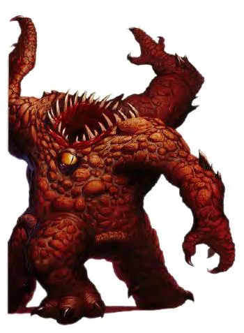

# Xorn

Criaturas bizarras nativas do Plano Elemental da Terra, os xorn farejam gemas e metais preciosos, então escavam através da terra e rochas para consumir esses tesouros. No Plano Material, os xorn devem ir bem profundamente no Subterrâneo para se sustentarem, tornando-se agressivos contra mineiros e caçadores de tesouros quando os valiosos minerais de suas dietas se tornam escassos.

A origem sobrenatural do xorn sugerida por seu corpo extraordinariamente pesado e por sua grande e poderosa boca localizada no topo de sua cabeça. Seus três longos braços são todos dotados de garras afiadas e seus três grandes olhos pétreos achatados veem em todas as direções.

***Viajantes Elementais***. Possuidor do poder elemental da terra, um xorn desliza pela rocha e terra com a mesma facilidade que um peixe nada através da água. Ele não desloca terra ou pedras quando se move, mas emerge dela e flui através dela, sem deixar qualquer túnel, buraco ou rastro de sua passagem.

Os xorns preferem não sair de seu plano natal, onde eles facilmente se empanturram de gemas e metais preciosos. Quando um xorn vem parar no Plano Material, quer seja por acidente ou por curiosidade, ele buscará sustento e um caminho para casa.

***Pedintes e Ladrões***. Os xorns vasculham as profundezas da terra atrás de metais e pedras preciosos. Por eles serem incapazes de consumir material orgânico, eles ignoram a maioria das outras criaturas. Porém, a habilidade do xorn de farejar metais e pedras frequentemente atrai sua atenção para aventureiros carregando moedas e gemas. Por um xorn não ser maligno, ele implora ou barganha na esperança de convencer donos a darem seus tesouros, oferecendo informações que ele aprendem eu suas viagens em troca. Um xorn cujos pedidos sejam ignorado pode recorrer a ameaças e intimidação. Se estiver faminto ou irritado, ele recorrerá à força.

## Bloco de estatísticas: Xorn

*Elemental Médio, neutro*

**Classe de Armadura** 19 (armadura natural)  
**Pontos de Vida** 73 (7d8 + 42)  
**Deslocamento** 6 m, escavação 6 m

| FOR | DES | CON | INT | SAB | CAR |
| :---: | :---: | :---: | :---: | :---: | :---: |
| 17 (+3) | 10 (+0) | 22 (+6) | 11 (+0) | 10 (+0) | 11 (+0) |

**Perícias** Furtividade +3, Percepção +6  
**Resistência a Dano** cortante e perfurante de ataques não-mágicos que não sejam de adamante  
**Sentidos** visão no escuro 18 m, sentido sísmico 18 m, Percepção passiva 16  
**Idiomas** Terran  
**Nível de Desafio** 5 (1.800 XP)

***Camuflagem Rochosa***. O xorn tem vantagem em testes de Destreza (Furtividade) feitos para se esconder em terreno rochoso.

***Deslizar na Terra***. O xorn pode escavar através de terra e rocha não-mágica bruta. Enquanto faz isso, o xorn não perturba o material pelo qual se move.

***Sentir Tesouro***. O xorn pode localizar precisamente, através do faro, metais e pedras preciosos, como moedas e gemas, a até 18 metros dele.

### Ações

***Ataques Múltiplos***. O xorn realiza três ataques de garra e um ataque de mordida.

***Garras***. *Ataque Corpo-a-Corpo com Arma*: +6 para atingir, alcance 1,5 m, um alvo. *Acerto*: 6 (1d6 + 3) de dano cortante.

***Mordida***. *Ataque Corpo-a-Corpo com Arma*: +6 para atingir, alcance 1,5 m, um alvo. *Acerto*: 13 (3d6 + 3) de dano perfurante.
