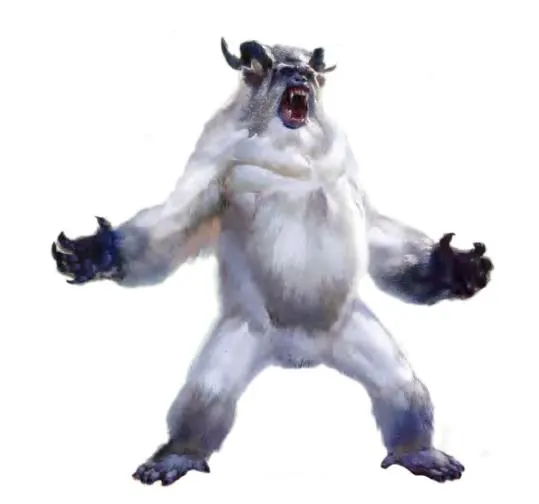

# Yetis

## Bloco de estatísticas: Yeti

*Monstruosidade Grande, caótico e mau*

**Classe de Armadura** 12 (armadura natural)  
**Pontos de Vida** 51 (6d10 + 18)  
**Deslocamento** 12 m, escalada 12 m

| FOR | DES | CON | INT | SAB | CAR |
| :---: | :---: | :---: | :---: | :---: | :---: |
| 18 (+4) | 13 (+1) | 16 (+3) | 8 (–1) | 12 (+1) | 7 (–2) |

**Perícias** Furtividade +3, Percepção +3  
**Imunidade a Dano** frio  
**Sentidos** visão no escuro 36 m, Percepção passiva 13  
**Idiomas** Yeti  
**Nível de Desafio** 3 (700 XP)

***Camuflagem de Neve***. O yeti tem vantagem em testes de Destreza (Furtividade) feitos em terrenos de neve.

***Faro Aguçado***. O yeti tem vantagem em testes de Sabedoria (Percepção) relacionados ao olfato.

***Medo de Fogo***. Se o yeti sofrer dano de fogo, ele terá desvantagem nas jogadas de ataque e testes de habilidade até o final do próximo turno dele.

### Ações

***Ataques Múltiplos***. O yeti usa seu Olhar Congelante e realiza dois ataques de garra.

***Garra***. *Ataque Corpo-a-Corpo com Arma*: +6 para atingir, alcance 1,5 m, um alvo. *Acerto*: 7 (1d6 + 4) de dano cortante mais 3 (1d6) de dano de frio.

***Olhar Congelante***. O yeti afeta uma criatura que ele possa ver, a até 9 metros dele. Se o alvo puder ver o yeti, ele deve ser bem sucedido num teste de resistência de Constituição CD 13 contra essa mágica ou sofrerá 10 (3d6) de dano de frio e ficará paralisado por 1 minuto, a não ser que seja imune a dano de frio. O alvo pode repetir o teste de resistência no final de cada um dos turnos dele, terminando o efeito sobre si com um sucesso. Se o teste de resistência do alvo for bem sucedido, ou se ele terminar o efeito sobre si, o alvo fica imune ao Olhar Congelante de todos os yetis (mas não dos yetis abomináveis) por 1 hora.

## Bloco de estatísticas: Yeti Abominável

*Monstruosidade Enorme, caótico e mau*

**Classe de Armadura** 15 (armadura natural)  
**Pontos de Vida** 137 (11d12 + 66)  
**Deslocamento** 12 m, escalada 12 m

| FOR | DES | CON | INT | SAB | CAR |
| :---: | :---: | :---: | :---: | :---: | :---: |
| 24 (+7) | 10 (+0) | 22 (+6) | 9 (–1) | 13 (+1) | 9 (–1) |

**Perícias** Furtividade +4, Percepção +5  
**Imunidade a Dano** frio  
**Sentidos** visão no escuro 36 m, Percepção passiva 15  
**Idiomas** Yeti  
**Nível de Desafio** 9 (5.000 XP)

***Camuflagem de Neve***. O yeti tem vantagem em testes de Destreza (Furtividade) feitos em terrenos de neve.

***Faro Aguçado***. O yeti tem vantagem em testes de Sabedoria (Percepção) relacionados ao olfato.

***Medo de Fogo***. Se o yeti sofrer dano de fogo, ele terá desvantagem nas jogadas de ataque e testes de habilidade até o final do próximo turno dele.

### Ações

***Ataques Múltiplos***. O yeti usa seu Olhar Congelante e realiza dois ataques de garra.

***Garra***. *Ataque Corpo-a-Corpo com Arma*: +11 para atingir, alcance 1,5 m, um alvo. *Acerto*: 14 (2d6 + 7) de dano cortante mais 7 (2d6) de dano de frio.

***Olhar Congelante***. O yeti afeta uma criatura que ele possa ver, a até 9 metros dele. Se o alvo puder ver o yeti, ele deve ser bem sucedido num teste de resistência de Constituição CD 18 contra essa mágica ou sofrerá 21 (6d6) de dano de frio e ficará paralisado por 1 minuto, a não ser que seja imune a dano de frio. O alvo pode repetir o teste de resistência no final de cada um dos turnos dele, terminando o efeito sobre si com um sucesso. Se o teste de resistência do alvo for bem sucedido, ou se ele terminar o efeito sobre si, o alvo fica imune ao Olhar Congelante de todos os yetis por 1 hora.

***Sopro Congelante (Recarrega 6)***. O yeti expele um cone de 9 metros de ar gelado. Cada criatura na área deve realizar um teste de resistência de Constituição CD 18, sofrendo 45 (10d8) de dano de frio caso fracassem, ou metade desse dano caso obtenham sucesso.

## Yetis

O uivo do yeti carregado pelo vento ecoa através das remotas montanhas, enchendo de medo o coração dos mineradores e pastores dispersos que vivem ali. Essas criaturas brutais espreitam nos picos alpinos em uma caçada incessante por comida. Sua pelagem branco-neve permite que eles se movam como fantasmas no ambiente congelado. O gélido olhar simiesco de um yeti pode congelar sua presa onde ela está.

***Caçadores Astutos***. O povo dos altos picos viajam em grupos e vão armados, sabendo que os yetis podem farejar carne viva a quilômetros de distância. Quando encontra sua presa, um yeti se move rapidamente pelo gelo e pedras para reivindicar sua refeição, uivando com a emoção da caçada. Mesmo na nevasca, o cheiro de suas presas guia o yeti pelo gelo e neve.

Os yetis caçam sozinhos ou em pequenos grupos familiares. Quando as criaturas fogem de um yeti ou se engajam em combate, outros yetis podem captar o cheiro de sangue e se aproximar. O yetis são territorialistas e lutam uns com os outros pelos espólios de tais batalhas, e os yetis mortos na luta também são devorados, em meio a uivos eufóricos.

***Uivadores Aterrorizantes***. Antes de uma avalanche, uma nevasca ou uma frio letal, o uivo de um yeti faz as encostas das montanhas descerem com o vento gelado. Alguns povos dos picos alpinos acreditam que as vozes dos seus entes queridos mortos em avalanches e nevascas são vocalizados nos gemidos dos yetis, como gritos de alerta de mau agouro. Povos mais pragmáticos atestam que o uivo do yeti é um lembrete de que, apesar das grandes realizações da civilização, os civilizados se tornaram a caça no domínio natural indomável.

***Destruidores Brutais***. Quando os rebanhos montanhosos são abundantes, os yetis ficam longe dos reinos humanoides. Levados pela fome, eles atacam colônias humanoides em ondas, arrombando portões e muros de paliçada que anteriormente os assustavam, em seguida, devorando as criaturas dentro deles.

Povos montanheses desonestos, às vezes, usam os yetis como armas involuntárias. Um senhor da guerra poderia plantar ovelhas ou cabras chacinadas para atrair yetis para o acampamento de um inimigo, semeando o caos e o desbaste das fileiras antes da batalha. Líderes de clãs da montanha, querendo expandir seus territórios, caçam excessivamente as presas locais para diminuir o suprimento de comida dos yetis, inspirando-os a atacar colônias humanoides que foram rapidamente anexadas na sequência.

***Yetis Abomináveis***. Um yeti abominável é maior que um yeti normal, medindo três vezes o tamanho de um humano. Ele geralmente vive e caça sozinho, apesar de um casal de yetis abomináveis poder viver junto tempo suficiente para criar seus filhotes. Esses yetis enormes são extremamente territorialistas e selvagens, atacando e devorando qualquer criatura de sangue quente que encontrarem, então partindo seus ossos contra o gelo e neve.
