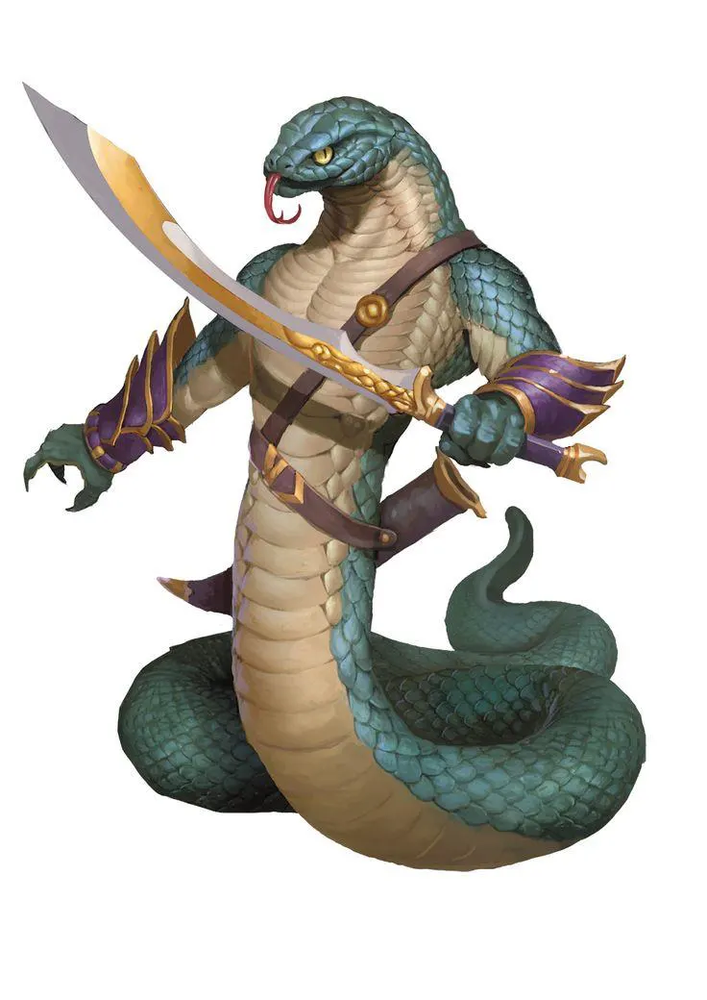
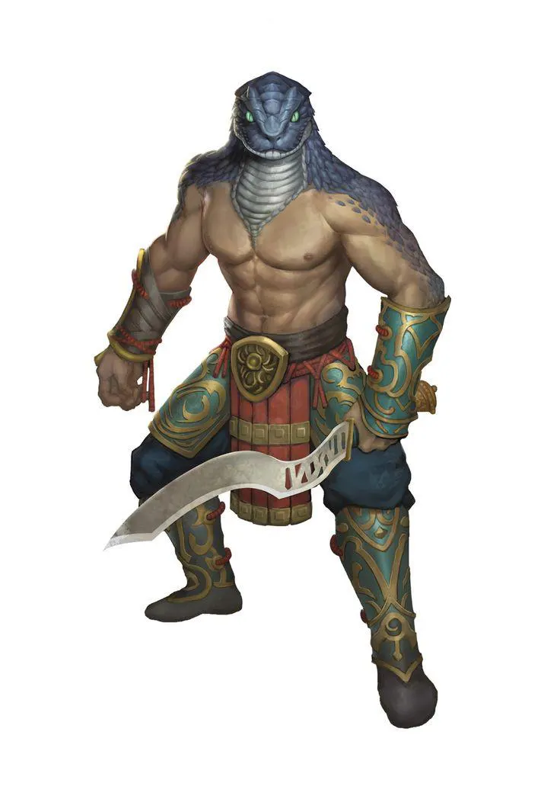
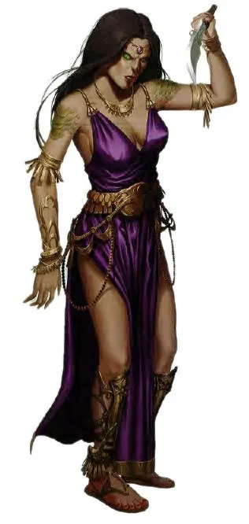

# Yuan-ti

Os yuan-ti são um povo serpente desleal desprovido de compaixão. De templos remotos em selvas, pântanos e desertos, os yuan-ti tramam para suplantar e dominar todas as outras raças e para fazerem de si mesmos deuses.

***Humanidade Abandonada***. Os yuan-ti já foram humanos que prosperaram nos primórdios da civilização e que adoravam as serpentes como animais totêmicos. Eles louvavam a flexibilidade da sinuosa serpente, seu equilíbrio calculado e seu bote mortal. Sua filosofia avançada ensinada a virtude do desprendimento emocional e do claro pensamento focado.

A cultura yuan-ti estava entre as mais ricas no mundo mortal. Seus guerreiros eram lendários, seus impérios sempre se expandindo. Os templos yuan-ti situavam-se nos centros das antigas metrópoles, alcançando patamares cada vez mais altos de oração aos deuses que eles desejavam imitar. Com o tempo, os deuses serpentes ouviram suas orações, suas vozes sibilantes responderam das trevas enquanto contavam aos yuan-ti o que eles deveriam fazer. A religião yuan-ti ficou ainda mais fanática em sua devoção. Os cultos prenderam-se à adoração dos deuses serpentes e imitaram seus meios, entregando-se ao canibalismo e sacrifício humanoide. Através de feitiçaria torpe, os yuan-ti procriaram com cobras, sacrificando sua humanidade totalmente para adquirirem a forma dos deuses serpentes, assim como seus pensamentos e emoções.

***Reis Serpentes de Impérios Caídos***. Os yuan-ti veem suas transformações físicas como um momento transcendental de sua raça, permitindo-lhes abandonar sua frágil humanidade como se fosse pele morta. Aqueles que não se transformaram, eventualmente se tornaram escravos ou comida para os abençoados dos deuses serpentes. Os impérios yuan-ti definharam ou foram destruídos por aqueles que lutavam contra o canibalismo e a escravidão e o povo serpente foi deixado nas ruínas de suas grandes capitais, bem longe das outras raças.

***Frios de Coração***. Emoções humanoides são estranhas para a maioria dos yuan-ti, que enxergam o sentimento apenas como uma fraqueza explorável. Um yuan-ti vê o mundo e os eventos de sua própria vida com pragmatismo extremo, que é quase impossível de manipular, influenciar ou controlar por meios não-mágicos, mesmo quando ele busca controlar outras criaturas através de terror, prazer ou reverência. De tempos em tempos, as culturas humanoides cometem o erro fatal de confiar nos yuan-ti. Eles esquecem que um yuan-ti age honradamente ou presta auxílio em tempos de angústia apenas como parte de um plano maior.

Os líderes yuan-ti são astutos e estrategistas implacáveis que prontamente sacrificam yuan-ti inferiores se a vitória em potencial justificar tais perdas. Eles não tem noção de combate honrado e atacam primeiro em emboscadas decisivas quando podem.

***Veneração Falsa***. A vida yuan-ti gira em torno de seus templos, mesmo que os yuan-ti não adorem os deuses que eles veneram. Ao invés disso, eles veem a veneração como um meio de adquirir poder. Um yuan-ti acredita que um indivíduo que consiga poder suficiente, pode devorar e substituir um dos deuses yuan-ti. Os yuan-ti esforçam-se para atingir a ascensão e estão dispostos a cometer as atrocidades mais obscuras para alcança-la.

### Yuan-Ti Abominação

Serpentes monstruosas com robustos torsos e braços humanoides, as abominações formam a mais alta casta da sociedade yuan-ti e são os membros da raça que mais se assemelham com os deuses serpentes que eles pretendem. Com suas mentes superiores, eles elaboram tramas e realizar ritos sombrios na esperança de um dia governarem o mundo.

## Bloco de estatísticas: Yuan-Ti Abominação

*Monstruosidade Grande (metamorfo, yuan-ti), neutro e mau*

**Classe de Armadura** 15 (armadura natural)  
**Pontos de Vida** 127 (15d10 + 45)  
**Deslocamento** 12 m

| FOR | DES | CON | INT | SAB | CAR |
| :---: | :---: | :---: | :---: | :---: | :---: |
| 19 (+4) | 16 (+3) | 17 (+3) | 17 (+3) | 15 (+2) | 18 (+4) |

**Perícias** Furtividade +6, Percepção +5  
**Imunidade a Dano** veneno  
**Imunidade a Condição** envenenado  
**Sentidos** visão no escuro 18 m, Percepção passiva 15  
**Idiomas** Abissal, Comum, Dracônico  
**Nível de Desafio** 7 (2.900 XP)

***Conjuração Inata***. A habilidade de conjuração de um yuan-ti é Carisma (CD de resistência de magia 15, +7 para atingir com ataques de magia). Ele pode conjurar, inatamente, as seguintes magias, sem necessidade de componentes materiais:

À vontade: *amizade animal* (cobras apenas) 3/dia: *sugestão* 1/dia: *medo*

***Metamorfo***. O yuan-ti pode usar sua ação para se metamorfosear em um cobra Grande, ou voltar para sua forma verdadeira. Suas estatísticas são as mesmas em cada forma. Qualquer equipamento que ele esteja vestindo ou carregando não é transformado. Ele reverte a sua forma verdadeira se morrer.

***Resistência à Magia***. O yuan-ti possui vantagem nos testes de resistência contra magias e outros efeitos mágicos.

### Ações

***Ataques Múltiplos (Forma de Abominação Apenas)***. O yuan-ti realiza dois ataques à distância ou três ataques corpo-a-corpo, mas só pode usar seus ataques de mordida e constrição uma vez cada.

***Mordida***. *Ataque Corpo-a-Corpo com Arma*: +7 para atingir, alcance 1,5 m, uma criatura. *Acerto*: 7 (1d6 + 4) de dano perfurante mais 10 (3d6) de dano de veneno.

***Constrição***. *Ataque Corpo-a-Corpo com Arma*: +7 para atingir, alcance 3 m, um alvo. *Acerto*: 11 (2d6 + 4) de dano de concussão e o alvo fica agarrado (CD 14 para escapar). Até esse agarrão acabar, o alvo está impedido e o yuan-ti não pode constringir outro alvo.

***Cimitarra (Forma de Abominação Apenas)***. *Ataque Corpo-a-Corpo* *com Arma*: +7 para atingir, alcance 1,5 m, um alvo. *Acerto*: 11 (2d6 + 4) de dano cortante.

***Arco Longo (Forma de Abominação Apenas)***. *Ataque à Distância* *com Arma*: +6 para atingir, distância 45/180 m, um alvo. *Acerto*: 12 (2d8 + 3) de dano perfurante mais 10 (3d6) de dano de veneno.

### Yuan-Ti Mestiço

Um mestiço é uma mistura medonha de um humano e traços serpentinos. Sabe-se da existência de três tipos diferentes de mestiços e outros tipos são possíveis. Os mestiços formam a casta do meio da sociedade yuan-ti e caçam com flechas embebidas com seu próprio veneno. Eles usam seus poderes mágicos de sugestão para forçar seus inimigos a se renderem.

## Bloco de estatísticas: Yuan-Ti Mestiço

*Monstruosidade Média (metamorfo, yuan-ti), neutro e mau*

**Classe de Armadura** 12  
**Pontos de Vida** 66 (12d8 + 12)  
**Deslocamento** 9 m

| FOR | DES | CON | INT | SAB | CAR |
| :---: | :---: | :---: | :---: | :---: | :---: |
| 16 (+3) | 14 (+2) | 13 (+1) | 14 (+2) | 12 (+1) | 16 (+3) |

**Perícias** Enganação +5, Furtividade +4  
**Imunidade a Dano** veneno  
**Imunidade a Condição** envenenado  
**Sentidos** visão no escuro 18 m, Percepção passiva 11  
**Idiomas** Abissal, Comum, Dracônico  
**Nível de Desafio** 3 (700 XP)

***Conjuração Inata***. A habilidade de conjuração de um yuan-ti é Carisma (CD de resistência de magia 13, +5 para atingir com ataques de magia). Ele pode conjurar, inatamente, as seguintes magias, sem necessidade de componentes materiais:

À vontade: *amizade animal* (cobras apenas) 3/dia: *sugestão*

***Metamorfo***. O yuan-ti pode usar sua ação para se metamorfosear em um cobra Média, ou voltar para sua forma verdadeira. Suas estatísticas são as mesmas em cada forma. Qualquer equipamento que ele esteja vestindo ou carregando não é transformado. Ele reverte a sua forma verdadeira se morrer.

***Tipo de Mestiço***. O yuan-ti possui um dos seguintes tipos:

**Tipo 1**: Corpo humano com cabeça de cobra  
**Tipo 1**: Cabeça e corpo humana com cobras no lugar dos braços  
**Tipo 1**: Cabeça e parte superior do corpo humano com parte inferior do corpo serpentina, no lugar das pernas

### Ações para o Tipo 1

***Ataques Múltiplos (Forma de Yuan-ti Apenas)***. O yuan-ti realiza dois ataques à distância ou dois ataques corpo-a-corpo, mas só pode usar sua mordida uma vez.

***Mordida***. *Ataque Corpo-a-Corpo com Arma*: +5 para atingir, alcance 1,5 m, uma criatura. *Acerto*: 5 (1d4 + 3) de dano perfurante mais 7 (2d6) de dano de veneno.

***Cimitarra (Forma de Yuan-ti Apenas)***. *Ataque Corpo-a-Corpo com* *Arma*: +5 para atingir, alcance 1,5 m, um alvo. *Acerto*: 6 (1d6 + 3) de dano cortante.

***Arco Longo (Forma de Yuan-ti Apenas)***. *Ataque à Distância com* *Arma*: +4 para atingir, distância 45/180 m, um alvo. *Acerto*: 6 (1d8 + 2) de dano perfurante mais 7 (2d6) de dano de veneno.

### Ações para o Tipo 2

***Ataques Múltiplos (Forma de Yuan-ti Apenas)***. O yuan-ti realiza dois ataques de mordida usando seus braços de cobra.

***Mordida***. *Ataque Corpo-a-Corpo com Arma*: +5 para atingir, alcance 1,5 m, uma criatura. *Acerto*: 5 (1d4 + 3) de dano perfurante mais 7 (2d6) de dano de veneno.

### Ações para o Tipo 3

***Ataques Múltiplos (Forma de Yuan-ti Apenas)***. O yuan-ti realiza dois ataques à distância ou dois ataques corpo-a-corpo, mas só pode usar sua constrição uma vez.

***Mordida (Forma de Cobra Apenas)***. *Ataque Corpo-a-Corpo com* *Arma*: +5 para atingir, alcance 1,5 m, uma criatura. *Acerto*: 5 (1d4 + 3) de dano perfurante mais 7 (2d6) de dano de veneno.

***Constrição***. *Ataque Corpo-a-Corpo com Arma*: +5 para atingir, alcance 1,5 m, um alvo. *Acerto*: 10 (2d6 + 3) de dano de concussão e o alvo fica agarrado (CD 13 para escapar). Até esse agarrão acabar, o alvo está impedido e o yuan-ti não pode constringir outro alvo.

***Cimitarra (Forma de Yuan-ti Apenas)***. *Ataque Corpo-a-Corpo com* *Arma*: +5 para atingir, alcance 1,5 m, um alvo. *Acerto*: 6 (1d6 + 3) de dano cortante.

***Arco Longo (Forma de Yuan-ti Apenas)***. *Ataque à Distância com* *Arma*: +4 para atingir, distância 45/180 m, um alvo. *Acerto*: 6 (1d8 + 2) de dano perfurante mais 7 (2d6) de dano de veneno.

### Yuan-Ti Puro-Sangue

Os puro-sangue formam a casta mais baixa da sociedade yuan-ti. Eles se assemelham muito com humanos, ainda assim, um puro-sangue não consegue se passar por um humano após um exame minucioso, pois sempre existirão indícios de sua verdadeira natureza, como partes da pele escamadas, olhos serpentinos, dentes pontiagudos ou uma língua bifurcada. Vestindo capas e capuzes, eles se disfarçam de seres humanos e se infiltram em terras civilizadas para coletar informações, sequestrar prisioneiros para interrogatório e sacrifícios e negociar com qualquer um que tenha algo que possa dar seguimento aos seus inúmeros planos.

> **Deuses Serpentes**
>
> Os yuan-ti reverenciam uma quantidade de poderosas entidades como deuses, incluindo os seguintes.
>
> ***Dendar, a Serpente Noturna***. Os seguidores de Dendar dizem que um dia ela irá ficar tão grande se alimentando dos medos e dos pesadelos do mundo que irá devorá-lo totalmente. Os yuan-ti que servem Dendar aterrorizam outras criaturas de todas as formas que puderem, aumentando e nutrindo os medos dos humanoides para alimentar a Serpente Noturna.
>
> ***Merrshaulk, Mestre do Abismo***. Merrshaulk é a divindade patrona há muito adormecida dos yuan-ti. Como a adoração a Merrshaulk diminuiu, ele adormeceu. Os sacerdotes de Merrshaulk são yuan-ti abominações que mantem tradições de sacrifício vivo e causar sofrimento em nome do deus. Com atos vis suficientes, as abominações acreditam que Merrshaulk irá acordar e devolver os yuan-ti ao seu local de direito.
>
> ***Sseth, a Morte Sibilante***. Sseth aparece como um yuan-ti da antiguidade na forma de um yuan-ti alado que afirma ser o avatar de Merrshaulk. Falando com a voz de Merrshaulk, Sseth prometeu tirar os yuan-ti do declínio e construir um novo império. Muitos yuan-ti suspeitaram por muito tempo que Sseth fosse um usurpador, tirando vantagem do sono de Merrshaulk para fazer de si mesmo um deus. Eles acreditam que Sseth pode até mesmo ter devorado Merrshaulk e agora responde às orações dos seguidores de Merrshaulk, conforme os sacerdotes convertem ou consomem mais adeptos teimosos de Merrshaulk.

## Bloco de estatísticas: Yuan-Ti Puro-Sangue

*Humanoide Médio (yuan-ti), neutro e mau*

**Classe de Armadura** 11  
**Pontos de Vida** 40 (9d8)  
**Deslocamento** 9 m

| FOR | DES | CON | INT | SAB | CAR |
| :---: | :---: | :---: | :---: | :---: | :---: |
| 11 (+0) | 12 (+1) | 11 (+0) | 13 (+1) | 12 (+1) | 14 (+2) |

**Perícias** Enganação +6, Furtividade +3, Percepção +3  
**Imunidade a Dano** veneno  
**Imunidade a Condição** envenenado  
**Sentidos** visão no escuro 18 m, Percepção passiva 13  
**Idiomas** Abissal, Comum, Dracônico  
**Nível de Desafio** 1 (200 XP)

***Conjuração Inata***. A habilidade de conjuração de um yuan-ti é Carisma (CD de resistência de magia 12, +4 para atingir com ataques de magia). Ele pode conjurar, inatamente, as seguintes magias, sem necessidade de componentes materiais:

À vontade: *amizade animal* (cobras apenas) 3/dia cada: rajada de veneno, *sugestão*

***Resistência à Magia***. O yuan-ti possui vantagem nos testes de resistência contra magias e outros efeitos mágicos.

### Ações

***Ataques Múltiplos***. O yuan-ti realiza dois ataques corpo-a-corpo.

***Cimitarra***. *Ataque Corpo-a-Corpo com Arma*: +3 para atingir, alcance 1,5 m, um alvo. *Acerto*: 4 (1d6 + 1) de dano cortante.

***Arco Curto***. *Ataque à Distância com Arma*: +3 para atingir, distância 24/96 m, um alvo. *Acerto*: 4 (1d6 + 1) de dano perfurante mais 7 (2d6) de dano de veneno.
