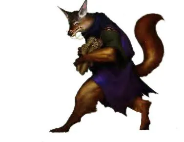
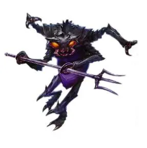
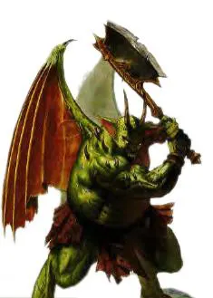
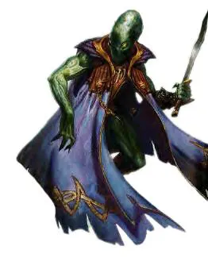

# Yugoloths

Os yugoloths são corruptores inconstantes que habitam os planos de Aqueronte, Geena, Hades e Cárceri. Eles agem como mercenários e são notórios por suas mudanças de lealdade. Eles são a encarnação da avareza. Antes de servir sob a bandeira de qualquer um, um yugoloth faz a única pergunta em sua cabeça: *O que eu vou ganhar?*

Crias de Geena. Os primeiros yugoloth foram criadas pela irmandade das bruxas da noite em Geena. Acredita-se amplamente que Asmodeu, Senhor dos Nove Infernos, encomendou o trabalho, na esperança de criar um exército de corruptores que não fossem presos aos Nove Infernos. No curso da criação desse novo exército, as bruxas construíram quatro tomos mágicos e gravaram o nome verdadeiro de cada yugoloth que elas criaram, exceto um, o General de Geena. Esses tomos foram chamados de *Livros de Custódia*. Já que saber o nome verdadeiro de um corruptor confere poderes sobre ele, as bruxas usaram os livros para garantir a lealdade dos yugoloths. Elas também usaram os livros para capturar os nomes verdadeiros de outros corruptores com quem cruzaram. Dizem os rumores que os *Livros de Custódia* contém o nome verdadeiro de alguns lordes demônios e arquidiabos também.

Ciúmes triviais e brigas infindáveis fizeram a irmandade se dissolver e na tomada de poder que se seguiu, os *Livros de Custódia* foram perdidos ou roubados. Não servindo a mais ninguém, os yugoloths ganharam a independência e agora oferecem seus serviços pelo pagamento mais alto.

***Corruptos Mercenários***. Os yugoloths invocados exigem muito pelo seu tempo e lealdade. O que quer que um yugoloth prometa, ele descumpre rapidamente quando uma oportunidade melhor aparece para ele. Diferente dos demônios, os yugoloths podem ser razoáveis, mas diferente dos diabos, eles raramente cumprem suas palavras.

Os yugoloths podem ser encontrados em qualquer lugar, mas os altos custos para manter a lealdade de um exército yugoloth geralmente excede o que qualquer general do Plano Material pode pagar.

Por serem criaturas egoístas, os yugoloths brigam entre si constantemente. Um exército yugoloth é mais organizado que uma horda voraz de demônios, mas é menos ordenado e regimentado que uma legião de diabos. Sem um líder poderoso para mantê-los na linha, os yugoloths lutam simplesmente para saciar suas predileções violentas e somente enquanto isso lhes trouxer algum benefício.

***De Volta a Geena***. Quando um yugoloth morre, ele se dissolve em uma poça de pus e se reforma com sua força total na Eternidade Gélida de Geena. Apenas em seu plano nativo um yugoloth pode ser destruído permanentemente. Um yugoloth sabe disso e age de acordo. Quando é invocado para outros planos, um yugoloth luta sem se preocupar com seu bem estar. Em Geena, ele está mais sujeito a recuar ou implorar por misericórdia se sua morte parecer iminente.

Quando um yugoloth é destruído permanentemente, seu nome desaparece de cada *Livro de Custódia*. Se um yugoloth for recriado por meio de um ritual profano que exija o uso de almas, seu nome reaparece nos livros.

***Os Livros de Custódia***. Quando todas as quatro cópias dos *Livros de Custódia* desapareceram, Asmodeu e as bruxas da noite perderam o controle sobre a criação dos yugoloths. Cada Livro de Custódia ainda existe, mudando de plano para plano, onde os bravos e os tolos ocasionalmente os encontram por acaso. Um yugoloth invocado usando seu nome verdadeiro como escrito nos *Livros de Custódia*, é forçado a servir seu invocador obedientemente. Um yugoloth odeia ser controlado dessa maneira e não tem vergonha de demonstrar seu descontentamento. Como uma criança petulante, ele irá seguir suas instruções ao pé da letra enquanto busca oportunidades de interpreta-las mal.

***O General de Geena***. Em algum lugar nos desertos de enxofre de Geena, perambula um ultroloth tão forte que ninguém contesta seu poder: o General de Geena. Muitos yugoloths buscam por esse grande general na esperança de servir com ele. Eles acreditam que servir com o General de Geena lhes garantirá poder e prestígio entre entidades planares menores.

Qualquer que seja o caso, nenhum corruptor encontra o General, a não ser que ele deseje isso. Seu nome pessoal é desconhecido e, mesmo os Livros de Custódia não tem qualquer menção a essa entidade poderosa e completamente maligna.

> **Variação: Invocação de Yugoloths**
>
> Alguns yugoloths podem ter uma opção de ação que os permite invocar outros yugoloths.
>
> ***Invocar Yugoloth (1/Dia)***. O yugoloth escolhe o que invocar e tenta uma invocação mágica.

 — Um **arcanaloth** tem 40 por cento de chance de invocar um

> arcanaloth.

 — Um **mezzoloth** em 30 por cento de chance de invocar um

> mezzoloth.

 — Um **nycaloth** tem 50 por cento de chance de invocar um 1d4

> mezzoloths ou um nycaloth.

 — Um **ultroloth** tem 50 por cento de chance de invocar 1d6

> mezzoloths, 1d4 nycaloths ou um ultroloth.
>
> Um yugoloth invocado aparece num espaço desocupado a até 18 metros do invocador, agindo como quiser (a não ser que seu invocador seja um ultroloth, nesse caso ele age como um aliado dele) e não pode invocar outros yugoloths. Ele permanece por 1 minuto, até seu invocador morrer ou até seu invocador o dispensar com uma ação.

### Arcanaloth

Os arcanaloths são astutos seres com cabeça de chacal e corpos humanoides, mas eles podem usar magia para assumir qualquer forma humanoide. Eles o fazem para ganhar a confiança de criaturas com quem tem que negociar, substituindo os rosnados de chacal por sorrisos cativantes.

Independentemente de sua forma escolhida, um arcanaloth está sempre bem arrumado, vestindo robes finos. Conjuradores altamente inteligentes famintos por conhecimento e poder, os arcanaloths comandam unidades de yugoloths inferiores e mantem os contratos, registros e contas da sua espécie.

Os arcanaloth falam e escrevem em todos os idiomas, o que faz deles diplomatas e negociantes ardilosos. Um arcanaloth pago apropriadamente pode negociar tratados ou alianças com sutileza e elegância, assim como um arcanaloth que mude de lado pode facilmente transformar tratados de paz em declarações de guerra. O que o corruptor exige em troca de seu tempo e talento são informações, assim como poderoso itens mágicos os quais ele pode negociar por ainda mais informação.

## Bloco de estatísticas: Arcanaloth

*Corruptor Médio (yugoloth), neutro e mau*

**Classe de Armadura** 17 (armadura natural)  
**Pontos de Vida** 104 (16d8 + 32)  
**Deslocamento** 9 m, voo 9 m

| FOR | DES | CON | INT | SAB | CAR |
| :---: | :---: | :---: | :---: | :---: | :---: |
| 17 (+3) | 12 (+1) | 14 (+2) | 20 (+5) | 16 (+3) | 17 (+3) |

**Testes de Resistência** Des +5, Int +9, Sab +7, Car +7  
**Perícias** Arcanismo +13, Enganação +9, Intuição +9, Percepção +7  
**Resistência a Dano** elétrico, fogo, frio; concussão, cortante e perfurante de ataques não-mágicos  
**Imunidade a Dano** ácido, veneno  
**Imunidade a Condição** enfeitiçado, envenenado  
**Sentidos** visão verdadeira 36 m, Percepção passiva 17  
**Idiomas** todos, telepatia 36 m  
**Nível de Desafio** 12 (8.400 XP)

***Armas Mágicas***. Os ataques com armas do arcanaloth são mágicos.

***Conjuração***. O arcanaloth é um conjurador de 16° nível. Sua habilidade de conjuração é Inteligência (CD de resistência de magia 17, +9 para atingir com ataques com magia). Ele possui as seguintes magias de mago preparadas:

Truques (à vontade): *ilusão menor, mãos mágicas, prestidigitação,* *raio de fogo* 1° nível (4 espaços): *detectar magia, disco flutuante de Tenser,* *escudo arcano, identificação* 2° nível (3 espaços): *detectar pensamentos, força fantasmagórica,* *reflexos, sugestão* 3° nível (3 espaços): *bola de fogo, contramágica, medo* 4° nível (3 espaços): *banimento, porta dimensional* 5° nível (3 espaços): *contato extraplanar, imobilizar monstro* 6° nível (1 espaços): *corrente de relâmpagos* 7° nível (1 espaços): *dedo da morte* 8° nível (1 espaços): *limpar a mente*

***Conjuração Inata***. A habilidade de conjuração de um arcanaloth é Carisma (CD de resistência de magia 15). Ele pode conjurar, inatamente, as seguintes magias, sem necessidade de componentes materiais:

À vontade: *alterar-se, escuridão, esquentar metal, invisibilidade* (pessoal apenas), *mísseis mágicos*

***Resistência à Magia***. O arcanaloth possui vantagem nos testes de resistência contra magias e outros efeitos mágicos.

### Ações

***Garras***. *Ataque Corpo-a-Corpo com Arma*: +7 para atingir, alcance 1,5 m, um alvo. *Acerto*: 8 (2d4 + 3) de dano cortante. O alvo deve realizar um teste de resistência de Constituição CD 14, sofrendo 10 (3d6) de dano de veneno se fracassar na resistência, ou metade desse dano se obtiver sucesso.

***Teletransporte***. O arcanaloth teletransporta-se magicamente, juntamente com qualquer equipamento que ele esteja vestindo ou carregando, para um espaço desocupado, a até 36 metros, que ele possa ver.

### Mezzoloth

A maior parte da população de yugoloths é composta de mezzoloths, que são criaturas insetoides de tamanho humano cobertas por densas placas quitinosas. Os mezzoloths servem como soldados de infantaria nos exércitos yugoloth, seus grandes olhos brilham vermelho conforme os mezzoloths destroem seus inimigos.

Violência e recompensa são as motivações fundamentais de um mezzoloth e seres poderosos que prometam um ou outro podem facilmente atrai-los a servir. Apesar de possuir garras letais em seus quatro braços, um mezzoloth geralmente empunha um tridente em duas delas. Se estiver cercado por inimigos, um mezzoloth expelirá vapores tóxicos que podem sufocar e matar grupos inteiros de criaturas.

## Bloco de estatísticas: Mezzoloth

*Corruptor Médio (yugoloth), neutro e mau*

**Classe de Armadura** 18 (armadura natural)  
**Pontos de Vida** 75 (10d8 + 30)  
**Deslocamento** 12 m

| FOR | DES | CON | INT | SAB | CAR |
| :---: | :---: | :---: | :---: | :---: | :---: |
| 18 (+4) | 11 (+0) | 16 (+3) | 7 (–2) | 10 (+0) | 11 (+0) |

**Perícias** Percepção +3  
**Resistência a Dano** elétrico, fogo, frio; concussão, cortante e perfurante de ataques não-mágicos  
**Imunidade a Dano** ácido, veneno  
**Imunidade a Condição** envenenado  
**Sentidos** percepção às cegas 18 m, visão no escuro 18 m, Percepção passiva 13  
**Idiomas** Abissal, Infernal, telepatia 36 m  
**Nível de Desafio** 5 (1.800 XP)

***Armas Mágicas***. Os ataques com armas do mezzoloth são mágicos.

***Conjuração Inata***. A habilidade de conjuração de um mezzoloth é Carisma (CD de resistência de magia 11). Ele pode conjurar, inatamente, as seguintes magias, sem necessidade de componentes materiais:

2/dia cada: *dissipar magia, escuridão* 1/dia: *névoa mortal*

***Resistência à Magia***. O mezzoloth possui vantagem nos testes de resistência contra magias e outros efeitos mágicos.

### Ações

***Ataques Múltiplos***. O mezzoloth realiza dois ataques: um com suas garras e um com seu tridente.

***Garras***. *Ataque Corpo-a-Corpo com Arma*: +7 para atingir, alcance 1,5 m, um alvo. *Acerto*: 9 (2d4 + 4) de dano cortante.

***Tridente***. *Ataque Corpo-a-Corpo ou à Distância com Arma*: +7 para atingir, alcance 1,5 m, distância 6/18 m, um alvo. *Acerto*: 7 (1d6 + 4) de dano perfurante, ou 8 (1d8 + 4) de dano perfurante se usada com as duas mãos para realizar ataques corpo-a-corpo.

***Teletransporte***. O mezzoloth teletransporta-se magicamente, juntamente com qualquer equipamento que ele esteja vestindo ou carregando, para um espaço desocupado, a até 36 metros, que ele possa ver.

### Nycaloth

Como a tropa de choque aérea de elite dos yugoloths, os nycaloths parecem gárgulas musculosos. Poderosas asas de morcego os carregam rapidamente para o alto em batalha e as garras afiadas como navalhas de suas mãos e pés cortam a carne e os ossos com facilidade. Como um adversários dos pesadelos, o nycaloth bate forte e rápido sem avisar, depois se teletransporta para longe. Ele usa sua magia inata para ficar invisível ou criar cópias ilusórias de si mesmo, assim confundindo seus inimigos.

Os nycaloths são os mais leais dentre os yugoloths. Quando eles encontram um mestre maligno que os trate bem, é improvável que eles desfaçam seus acordos a não ser que a recompensa por isso seja extrema.

## Bloco de estatísticas: Nycaloth

*Corruptor Grande (yugoloth), neutro e mau*

**Classe de Armadura** 18 (armadura natural)  
**Pontos de Vida** 123 (13d10 + 52)  
**Deslocamento** 12 m, voo 18 m

| FOR | DES | CON | INT | SAB | CAR |
| :---: | :---: | :---: | :---: | :---: | :---: |
| 20 (+5) | 11 (+0) | 19 (+4) | 12 (+1) | 10 (+0) | 15 (+2) |

**Perícias** Furtividade +4, Intimidação +6, Percepção +4  
**Resistência a Dano** elétrico, fogo, frio; concussão, cortante e perfurante de ataques não-mágicos  
**Imunidade a Dano** ácido, veneno  
**Imunidade a Condição** envenenado

**Sentidos** percepção às cegas 18 m, visão no escuro 18 m, Percepção passiva 14  
**Idiomas** Abissal, Infernal, telepatia 36 m  
**Nível de Desafio** 9 (5.000 XP)

***Armas Mágicas***. Os ataques com armas do nycaloth são mágicos.

***Conjuração Inata***. A habilidade de conjuração de um nycaloth é Carisma (CD de resistência de magia 14). Ele pode conjurar, inatamente, as seguintes magias, sem necessidade de componentes materiais:

À vontade: *detectar magia, escuridão, dissipar magia,* *invisibilidade* (pessoal apenas), *reflexos*

***Resistência à Magia***. O nycaloth possui vantagem nos testes de resistência contra magias e outros efeitos mágicos.

### Ações

***Ataques Múltiplos***. O nycaloth realiza dois ataques corpo-a-corpo, ou realiza um ataque corpo-a-corpo e se teletransporta antes ou depois do ataque.

***Garras***. *Ataque Corpo-a-Corpo com Arma*: +9 para atingir, alcance 1,5 m, um alvo. *Acerto*: 12 (2d6 + 5) de dano cortante. Se o alvo for uma criatura, ele deve ser bem sucedido num teste de resistência de Constituição CD 16 ou sofrerá 5 (2d4) de dano cortante no início de cada um dos turnos dele devido ao ferimento sobrenatural. Cada vez que o nycaloth atingir o alvo ferido com seus ataques, o dano causado pelo ferimento aumenta em 5 (2d4). Qualquer criatura pode usar uma ação para estancar o ferimento com um teste bem sucedido de Sabedoria (Medicina) CD 13. O ferimento também se fecha se o alvo receber cura mágica.

***Machado Grande***. *Ataque Corpo-a-Corpo com Arma*: +9 para atingir, alcance 1,5 m, um alvo. *Acerto*: 18 (2d12 + 5) de dano cortante.

***Teletransporte***. O nycaloth teletransporta-se magicamente, juntamente com qualquer equipamento que ele esteja vestindo ou carregando, para um espaço desocupado, a até 36 metros, que ele possa ver.

## Bloco de estatísticas: Ultroloth

*Corruptor Médio (yugoloth), neutro e mau*

**Classe de Armadura** 19 (armadura natural)  
**Pontos de Vida** 153 (18d8 + 72)  
**Deslocamento** 9 m, voo 18 m

| FOR | DES | CON | INT | SAB | CAR |
| :---: | :---: | :---: | :---: | :---: | :---: |
| 16 (+3) | 16 (+3) | 18 (+4) | 18 (+4) | 15 (+2) | 19 (+4) |

**Perícias** Furtividade +8, Intimidação +9, Percepção +7  
**Resistência a Dano** elétrico, fogo, frio; concussão, cortante e perfurante de ataques não-mágicos  
**Imunidade a Dano** ácido, veneno  
**Imunidade a Condição** amedrontado, enfeitiçado, envenenado  
**Sentidos** visão verdadeira 36 m, Percepção passiva 17  
**Idiomas** Abissal, Infernal, telepatia 36 m  
**Nível de Desafio** 13 (10.000 XP)

***Armas Mágicas***. Os ataques com armas do ultroloth são mágicos.

***Conjuração Inata***. A habilidade de conjuração de um ultroloth é Carisma (CD de resistência de magia 17). Ele pode conjurar, inatamente, as seguintes magias, sem necessidade de componentes materiais:

À vontade: *alterar-se, clarividência, detectar magia, detectar* *pensamentos, escuridão, dissipar magia, invisibilidade* (pessoal apenas), *sugestão* 3/dia cada: *medo, muralha de fogo, porta dimensional* 1/dia cada: *tempestade de fogo, sugestão em massa*

***Resistência à Magia***. O ultroloth possui vantagem nos testes de resistência contra magias e outros efeitos mágicos.

### Ações

***Ataques Múltiplos***. O ultroloth pode usar seu Olhar Hipnótico e realizar três ataques corpo-a-corpo.

***Espada Longa***. *Ataque Corpo-a-Corpo com Arma*: +8 para atingir, alcance 1,5 m, um alvo. *Acerto*: 7 (1d8 + 3) de dano cortante, ou 8 (1d10 + 3) de dano cortante se usada com as duas mãos.

***Olhar Hipnótico***. Os olhos do ultroloth cintilam com uma luz opalescente conforme ele afeta uma criatura que ela possa ver, a até 9 metros dele. Se o alvo puder ver o ultroloth, ele deve ser bem sucedido num teste de resistência de Sabedoria CD 17 contra essa magia, ou ficará enfeitiçado até o final do próximo turno do ultroloth. O alvo enfeitiçado fica atordoado. Se o alvo for bem sucedido no teste de resistência, ele fica imune ao olhar do ultroloth pelas próximas 24 horas.

***Teletransporte***. O ultroloth teletransporta-se magicamente, juntamente com qualquer equipamento que ele esteja vestindo ou carregando, para um espaço desocupado, a até 36 metros, que ele possa ver.

### Ultroloth

Os ultroloths comandam os exércitos yugoloth na Guerra Sangrenta. Um ultroloth parece um humanoide magro de pele acinzentada e com uma cabeça alongada. Sua cabeça não tem quaisquer traços além de dois olhos ovais. Esses olhos podem se transformar em poços cintilantes de luz capazes de transfixar outras criaturas, deixando-as tontas e indefesas.

Frequentemente uns contra os outros, os ultroloths planejam continuamente para aprimorar seu próprio poder. Quando não são contratados para lutar na Guerra Sangrenta, os ultroloths lideram forças yugoloth através dos planos, agindo como chefes do crime ou comandantes de companhias de mercenários malignos.

Com uma reputação de crueldade, os ultroloths comandam seus lacaios a lutar enquanto os ultroloths permanecem fora do combate. Yugoloths inferiores conhecem seu lugar quando confrontam um ultroloth e respondem a seus chamados sem exigir qualquer pagamento.
