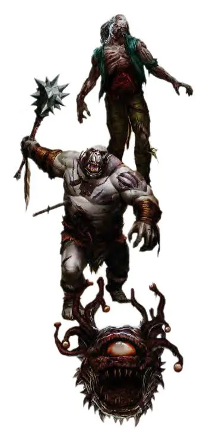

# Zumbis

De algum lugar na escuridão, um gemido embrulhado é ouvido. Uma forma cambaleante aparece, arrastando um pé conforme ergue seus braços inchados e mãos quebradas. O zumbi avança, impelido a matar qualquer um lento demais para escapar de suas garras.

***Servos das Trevas***. Magia necromântica sinistra infunde os restos dos mortos, fazendo-os se erguerem como zumbis que fazem o que seus criadores ordenam sem medo ou hesitação. Eles se movem contorcendo-se, andando irregularmente, vestidos em com os trapos das roupas que eles usavam quando foram colocados para descansar e carregam o cheiro da decomposição.

A maioria dos zumbis são feitos de restos humanoides, apesar da carne e ossos de qualquer criatura anteriormente viva poder ser imbuído com um semblante de vida. Mágica necromântica, geralmente de magias, anima um zumbi. Alguns zumbis levantam espontaneamente quando magia negra satura uma área. Uma vez transformado em zumbi, uma criatura não pode ser trazida de volta à vida, exceto por mágica poderosa, como a magia *ressurreição*.

Um zumbi não mantem qualquer vestígio de seu eu anterior, sua mente é desprovida de pensamentos ou imaginação. Um zumbi deixado sem ordens, fica simplesmente parado e apodrece a não ser que algo que ele possa matar se aproxime. A mágica animando um zumbi o infunde com maldade, portanto, deixando sem propósito, ele ataca qualquer criatura viva que encontrar.

***Formas Hediondas***. Os zumbis se parecem como eram em vida, expondo os ferimentos que os mataram. Porém, a mágica que cria essas criaturas vis frequentemente leva tempo para funcionar. Guerreiros mortos podem se erguer de um campo de batalha, eviscerados e inchados após dias sob o sol. O cadáver enlameado de um camponês pode escavar seu caminho para fora do solo, infestado de larvas e vermes. Um zumbi pode sair da praia ou de um pântano, inchado e pútrido após semanas dentro da água.

***Soldados Sem Mente***. Os zumbis tomam o caminho mais direto a qualquer oponente, incapaz de compreender obstáculos, táticas ou terreno perigoso. Um zumbi pode ser cambalear por um rio de correnteza forte ao tentar alcançar seus inimigos na outra margem, rastejando até a superfície enquanto se choca contra as rochas e é destruído. Para alcançar um inimigo abaixo dele, um zumbi pode pular para fora de uma janela. Zumbis cambaleiam pelo meio de incêndios infernais, poças de ácido e através de campos repletos de estrepes sem hesitar.

Um zumbi pode seguir ordens simples e distinguir amigos de inimigos, mas sua capacidade de raciocinar é limitada a cambalear em qualquer que seja a direção apontada, esmurrando qualquer inimigo no caminho. Um zumbi armado com uma arma a utiliza, mas um zumbi não irá recuperar uma arma que tenha caído ou outra ferramenta, até ser ordenado a fazê-lo.

***Natureza Morta-Viva***. Um zumbi não precisa respirar, comer, beber ou dormir.

## Bloco de estatísticas: Zumbi

*Morto-vivo Médio, neutro e mau*

**Classe de Armadura** 8  
**Pontos de Vida** 22 (3d8 + 9)  
**Deslocamento** 6 m

| FOR | DES | CON | INT | SAB | CAR |
| :---: | :---: | :---: | :---: | :---: | :---: |
| 13 (+1) | 6 (–2) | 16 (+3) | 3 (–4) | 6 (–2) | 5 (–3) |

**Testes de Resistência** Sab +0  
**Imunidade a Dano** veneno  
**Imunidade a Condição** envenenado  
**Sentidos** visão no escuro 18 m, Percepção passiva 8  
**Idiomas** compreende os idiomas que conhecia em vida, mas não pode falar  
**Nível de Desafio** 1/4 (50 XP)

***Fortitude de Morto-Vivo***. Se dano reduziria o zumbi a 0 pontos de vida, ele pode realizar um teste de resistência de Constituição com CD igual a 5 + o dano sofrido, a não ser que o dano seja radiante ou de um acerto crítico. Se obtiver sucesso, ele cairá a 1 ponto de vida, no lugar.

### Ações

***Pancada***. *Ataque Corpo-a-Corpo com Arma*: +3 para atingir, alcance 1,5 m, um alvo. *Acerto*: 4 (1d6 + 1) de dano de concussão.

## Bloco de estatísticas: Ogro Zumbi

*Morto-vivo Grande, neutro e mau*

**Classe de Armadura** 8  
**Pontos de Vida** 85 (9d10 + 36)  
**Deslocamento** 9 m

| FOR | DES | CON | INT | SAB | CAR |
| :---: | :---: | :---: | :---: | :---: | :---: |
| 19 (+4) | 6 (–2) | 18 (+4) | 3 (–4) | 6 (–2) | 5 (–3) |

**Testes de Resistência** Sab +0  
**Imunidade a Dano** veneno  
**Imunidade a Condição** envenenado  
**Sentidos** visão no escuro 18 m, Percepção passiva 8  
**Idiomas** compreende Comum e Gigante, mas não pode falar  
**Nível de Desafio** 2 (450 XP)

***Fortitude de Morto-Vivo***. Se dano reduziria o zumbi a 0 pontos de vida, ele pode realizar um teste de resistência de Constituição com CD igual a 5 + o dano sofrido, a não ser que o dano seja radiante ou de um acerto crítico. Se obtiver sucesso, ele cairá a 1 ponto de vida, no lugar.

### Ações

***Maça Estrela***. *Ataque Corpo-a-Corpo com Arma*: +6 para atingir, alcance 1,5 m, um alvo. *Acerto*: 13 (2d8 + 4) de dano de concussão.

## Bloco de estatísticas: Observador Zumbi

*Morto-vivo Grande, neutro e mau*

**Classe de Armadura** 15 (armadura natural)  
**Pontos de Vida** 93 (11d10 + 33)  
**Deslocamento** 0 m, voo 6 m (planar)

| FOR | DES | CON | INT | SAB | CAR |
| :---: | :---: | :---: | :---: | :---: | :---: |
| 10 (+0) | 8 (–1) | 16 (+3) | 3 (–4) | 8 (–1) | 5 (–3) |

**Testes de Resistência** Sab +2  
**Imunidade a Dano** veneno  
**Imunidade a Condição** caído, envenenado  
**Sentidos** visão no escuro 18 m, Percepção passiva 9  
**Idiomas** compreende Dialeto Subterrâneo, Subcomum, mas não pode falar  
**Nível de Desafio** 5 (1.800 XP)

***Fortitude de Morto-Vivo***. Se dano reduziria o zumbi a 0 pontos de vida, ele pode realizar um teste de resistência de Constituição com CD igual a 5 + o dano sofrido, a não ser que o dano seja radiante ou de um acerto crítico. Se obtiver sucesso, ele cairá a 1 ponto de vida, no lugar.

### Ações

***Mordida***. *Ataque Corpo-a-Corpo com Arma*: +3 para atingir, alcance 1,5 m, um alvo. *Acerto*: 14 (4d6) de dano perfurante.

***Raios Oculares***. O zumbi dispara um raio ocular mágico aleatoriamente, escolhendo um alvo que ele possa ver a até 18 metros dele:

*1. Raio Paralisante*. A criatura alvo deve ser bem sucedida num teste de resistência de Constituição CD 14 ou ficará paralisada por 1 minuto. O alvo pode repetir o teste de resistência no final de cada um dos turnos dele, terminando o efeito sobre si com um sucesso. 2. *Raio Apavorante*. A criatura alvo deve ser bem sucedida num teste de resistência de Sabedoria CD 14 ou ficará amedrontada pelo tirano por 1 minuto. O alvo pode repetir o teste de resistência no final de cada um dos turnos dele, terminando o efeito sobre si com um sucesso. *3. Raio Enervante*. A criatura alvo deve realizar um teste de resistência de Constituição CD 14, sofrendo 36 (8d8) de dano necrótico num fracasso na resistência, ou metade desse dano caso seja bem sucedido. *4. Raio Desintegrador*. Se o alvo for uma criatura, ela deve ser bem sucedida num teste de resistência de Destreza CD 14 ou o sofrerá 45 (10d8) de dano de energia. Se esse dano reduzir a criatura a 0 pontos de vida, seu corpo torna-se uma pilha de fina poeira cinzenta. Se o alvo for um objeto não-mágico ou uma criação de energia mágica Grande ou menor, ele é desintegrado sem teste de resistência. Se o alvo for um objeto ou uma criação de energia mágica Enorme ou maior, o raio desintegra 3 metros cúbicos dele.
